# Maqueta navegable · Documentación

Software de transcripción y anonimización de documentos escaneados para el Il·lustre Col·legi de l'Advocacia de Tarragona (ICAT).

| | |
|---|---|
| Fichero | `maqueta/index.html` (un único fichero, sin instalación) |
| Prueba automática | `maqueta/recorrido.py` |
| Idiomas | Catalán por defecto, castellano con un clic |
| Datos | Ficticios. Ningún dato real del Colegio |
| Fecha | Noviembre de 2026 |

## 1. Qué es

Es una simulación del flujo completo de la aplicación, de principio a fin, con el diseño de la propuesta. No hay servidor ni OCR real: el procesado, las lecturas dudosas y la detección de datos personales están preparados de antemano para que el recorrido sea siempre igual en una demo.

Sirve para tres cosas:

1. **Enseñar al cliente** qué ve y qué hace el usuario en cada paso.
2. **Validar el diseño** antes de programar (pasándola a Figma, ver § 6).
3. **Servir de referencia** al equipo de frontend y backend: cada pantalla corresponde a una parte del contrato de la API.

## 2. Cómo abrirla y presentarla

- Doble clic en `maqueta/index.html`; se abre en el navegador.
- **Guía de la demo** (abajo a la derecha): lista los 8 pasos y permite saltar a cualquiera. Se cierra con ✕.
- **Rutas directas**: cada pantalla tiene su dirección (`index.html#revisio`, `#jg`…), útil para saltar en la presentación o para importarla a Figma.
- **Idioma**: botones CA / ES de la cabecera.
- **Reiniciar**: recargar la página devuelve la demo al estado inicial.

## 3. Recorrido pantalla a pantalla

### 3.1 Acceso (`#login`)

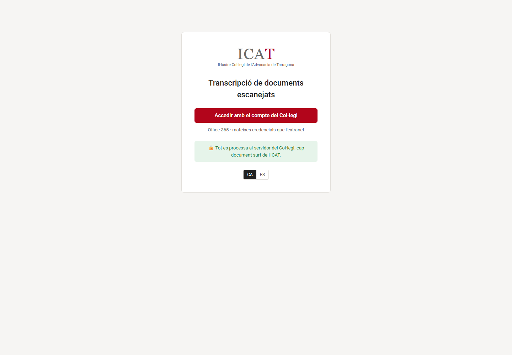

- **Ve**: el logotipo del Colegio, el botón de acceso con la cuenta del Colegio (Office 365, mismas credenciales que la extranet) y el aviso de que todo se procesa en local.
- **Hace**: entra con un clic.
- **Cubre**: acceso con las credenciales que ya usan; procesamiento 100 % local como argumento principal.

### 3.2 Bandeja (`#safata`)

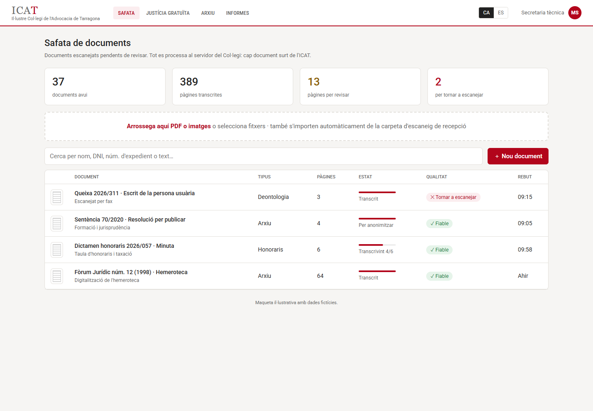

- **Ve**: cuatro indicadores (documentos de hoy, páginas transcritas, páginas por revisar y por volver a escanear), la zona para arrastrar ficheros, el buscador y la lista de documentos con su tipo, páginas, estado y semáforo de calidad.
- **Hace**: arrastra un PDF o pulsa «Nou document»; busca por nombre, DNI, número de expediente o texto; abre un documento.
- **Cubre**: bandeja con estado y semáforo por página; importación desde la carpeta del escáner; búsqueda.

### 3.3 Transcripción con semáforo (`#processant`)

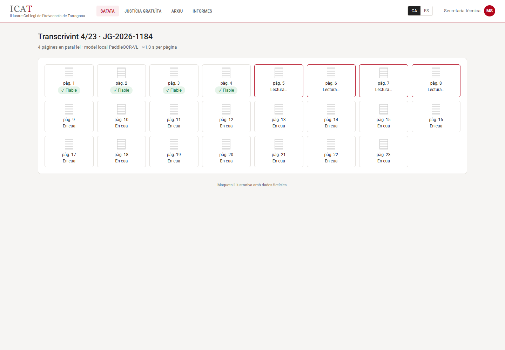

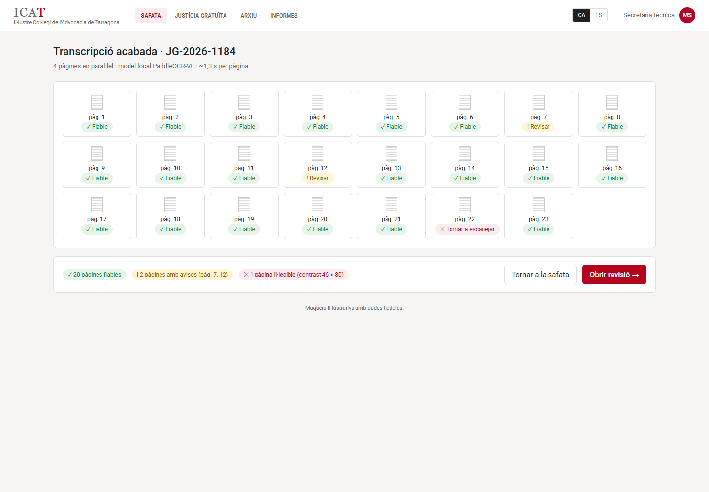

- **Ve**: las 23 páginas del expediente pasando por «contraste → lectura → resultado», de 4 en 4 (como en las pruebas de rendimiento del OCR). Al terminar, el resumen: 20 fiables, 2 con avisos y 1 ilegible.
- **Hace**: espera unos segundos y abre la revisión.
- **Cubre**: semáforo de calidad antes del OCR. La página 22 tiene contraste 46, por debajo del umbral de 80, y **no se transcribe**, porque el modelo inventaría texto.

### 3.4 Revisión (`#revisio`)

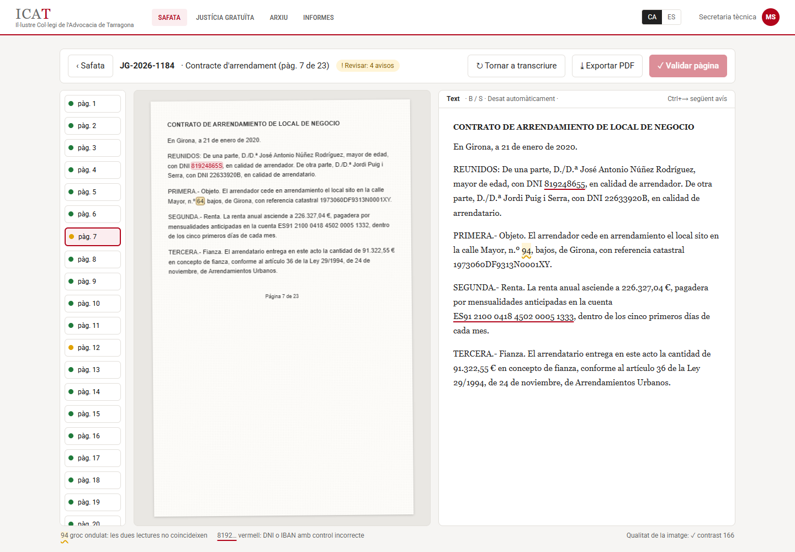

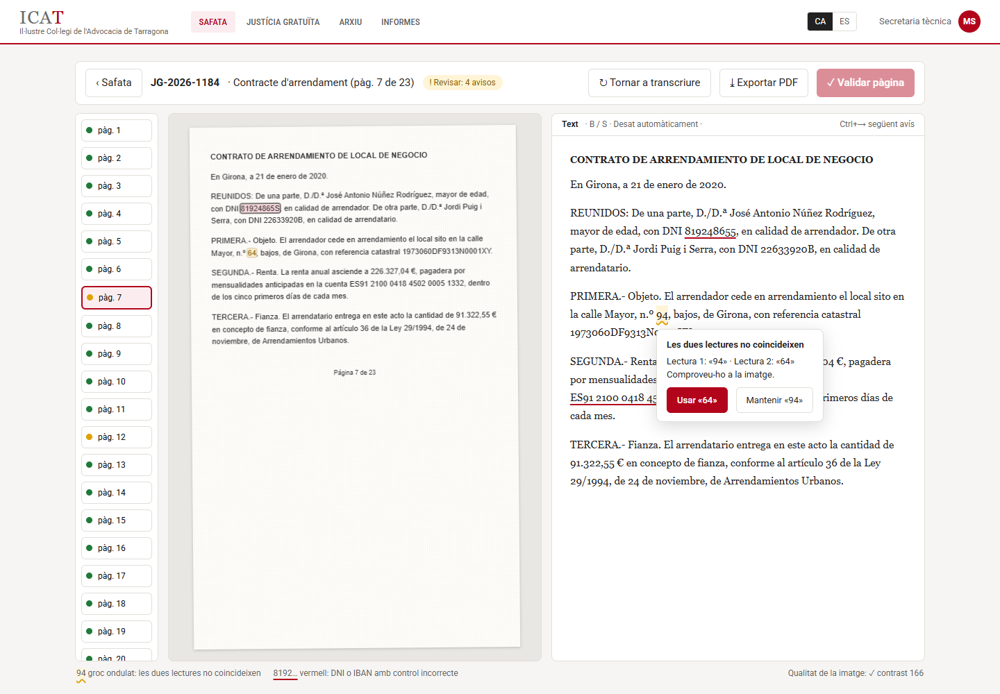

- **Ve**: a la izquierda las páginas con su color; en el centro la imagen escaneada; a la derecha el texto editable en letra de documento (Georgia). Los avisos van marcados:
  - **Ámbar ondulado**: las dos lecturas del OCR no coinciden («94» o «64»).
  - **Granate**: DNI con formato o letra incorrectos («819248655», donde el OCR leyó una S como 5) e IBAN con el dígito de control mal.
- **Hace**:
  - Al pasar el ratón (o el foco del teclado) por un aviso, **se marca la misma palabra en la imagen** para compararla.
  - Al pulsar, elige la lectura correcta o acepta la corrección propuesta.
  - «Validar pàgina» **no se activa hasta resolver todos los avisos** de la página. Ctrl+→ salta al siguiente aviso.

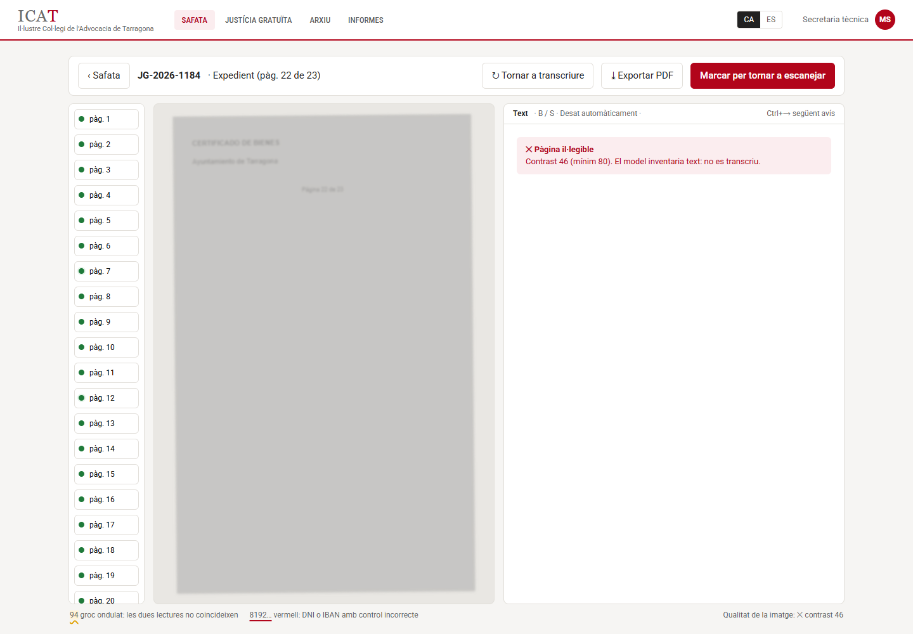

- En la página ilegible no hay texto que validar: se marca para volver a escanear.

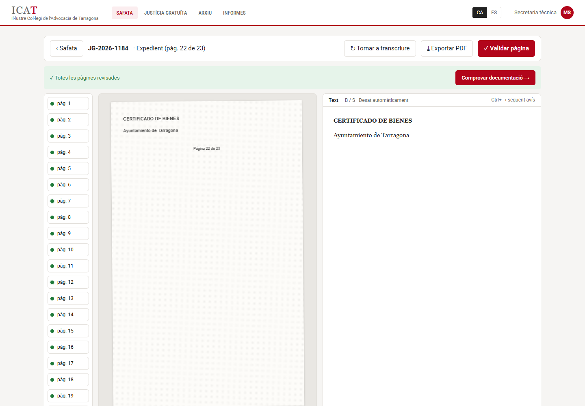

- **Cubre**: revisión imagen/texto con dudas marcadas (dos lecturas, DNI/NIE, IBAN); la herramienta ayuda, la persona decide.

### 3.5 Justicia gratuita (`#jg`)

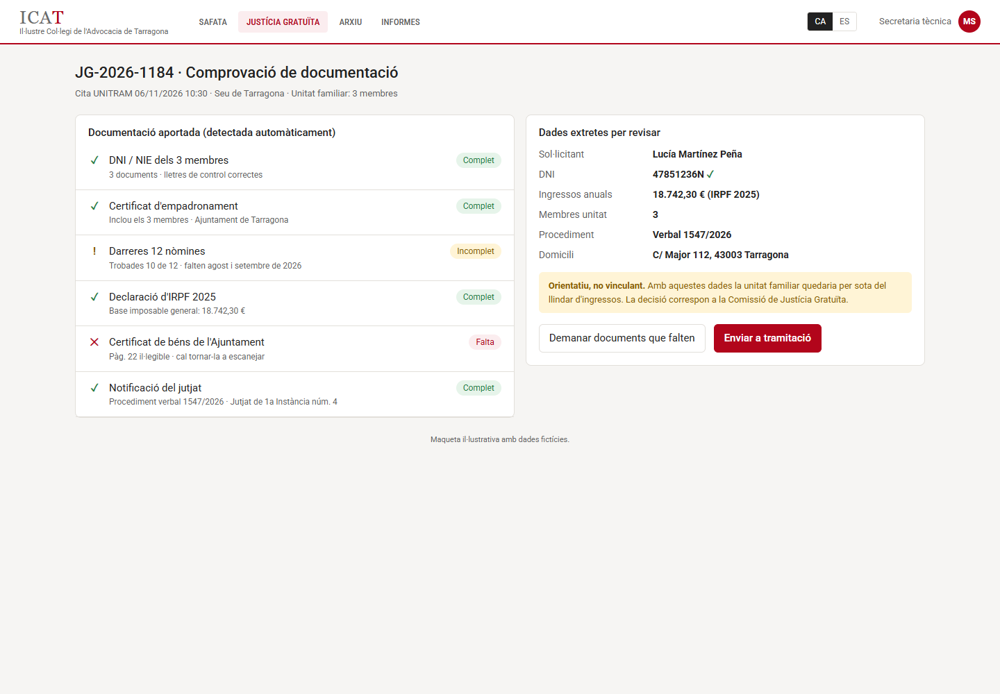

- **Ve**: la lista de documentos que exige el expediente, reconocidos automáticamente (DNI, empadronamiento, 12 nóminas, IRPF, certificado de bienes, notificación), cada uno con su estado. Al lado, los datos extraídos (solicitante, DNI validado, ingresos, miembros, procedimiento, domicilio) y el aviso **«Orientatiu, no vinculant»**.
- **Hace**: pide los documentos que faltan con un mensaje ya redactado, o envía el expediente a tramitación.

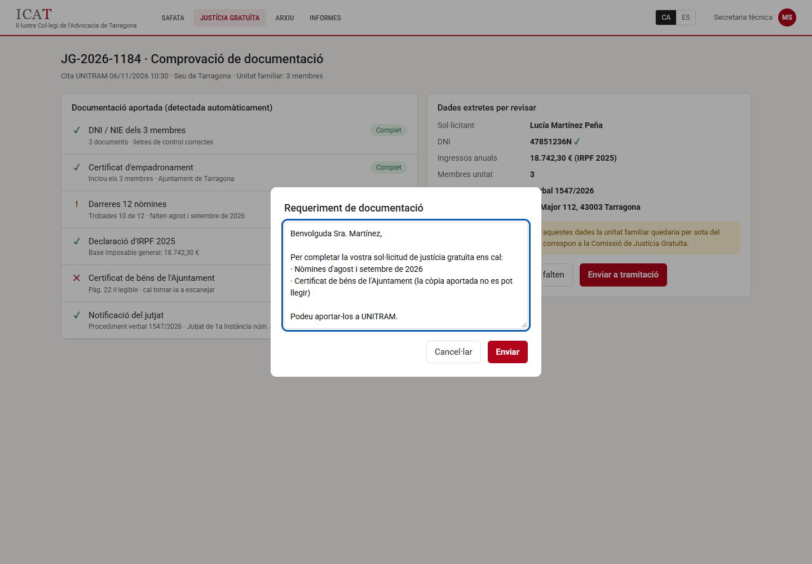

- **Cubre**: lista de comprobación de justicia gratuita; ficha de datos para la tramitación; el certificado de bienes ilegible de la revisión aparece aquí como «Falta». La decisión es de la Comisión.

### 3.6 Anonimización (`#anonimitzar`)

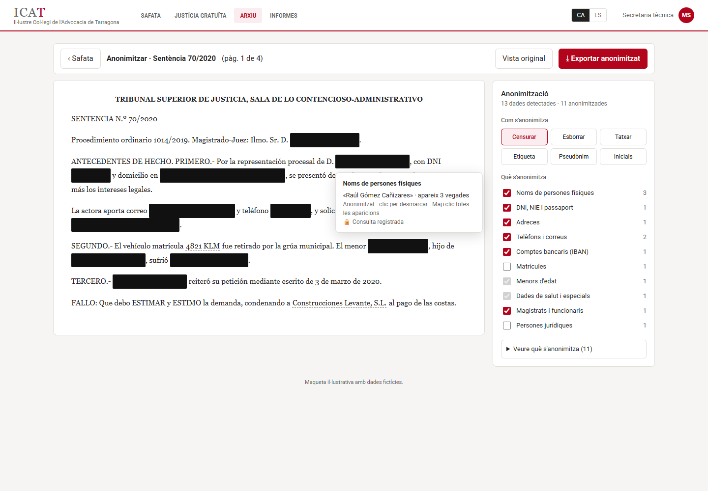

- **Ve**: el documento con los datos tapados y, a la derecha, el panel con:
  - **Com s'anonimitza**: censurar, borrar, tachar, etiqueta, seudónimo e iniciales.
  - **Què s'anonimitza**: una casilla por categoría con el número de datos encontrados. Menores y datos de salud están siempre activos; personas jurídicas y matrículas, desactivadas por defecto, como en el CENDOJ.
  - **Veure què s'anonimitza**: la lista de todo lo tapado.
- **Hace**:
  - Al pasar el ratón por un dato aparece su ficha: tipo, texto original y cuántas veces aparece. La consulta queda registrada.
  - Clic: tapa o destapa ese dato. Mayúsculas+clic: todas sus apariciones.
  - Los datos detectados pero no tapados quedan subrayados con trazo discontinuo.
  - «Vista original» alterna con el documento sin anonimizar.

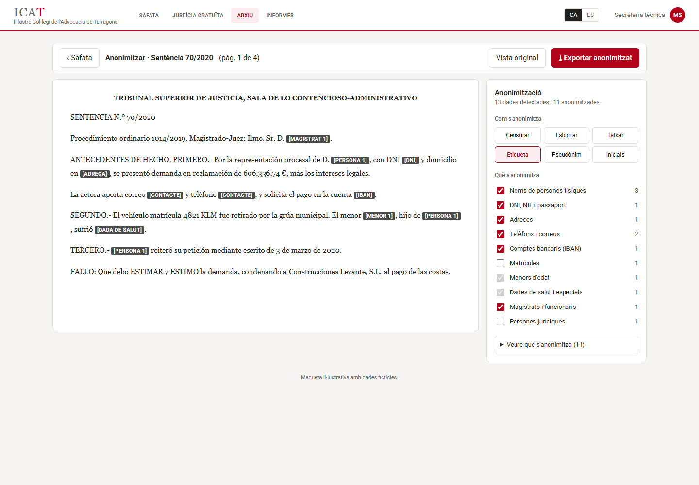

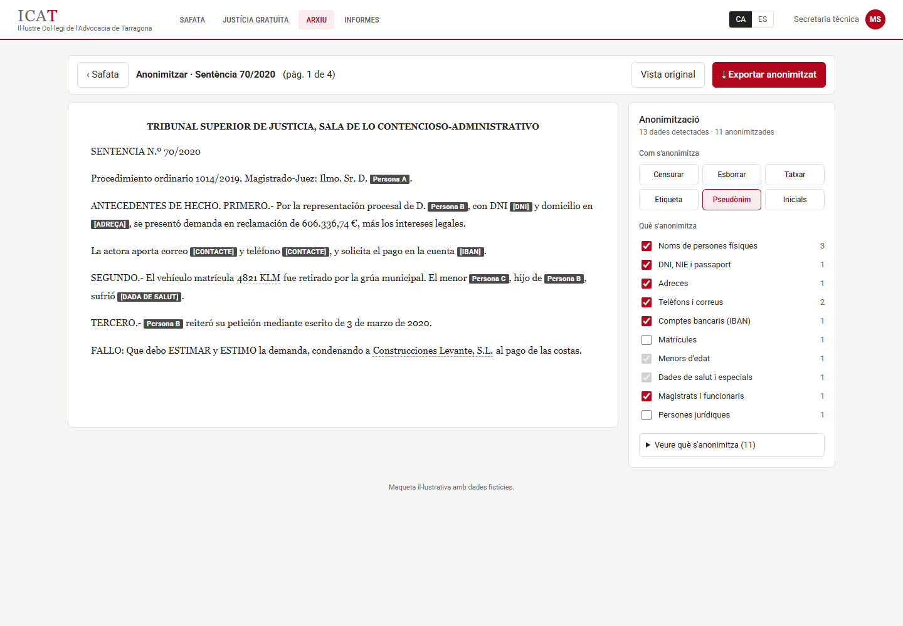

- En **seudónimo**, la misma persona recibe siempre la misma letra en todo el documento («Persona B»).
- En **tachar**, un aviso recuerda que no anonimiza: solo sirve para revisión interna.

### 3.7 Exportación (`#exportat`)

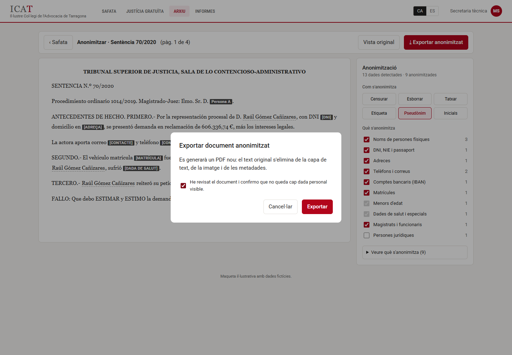

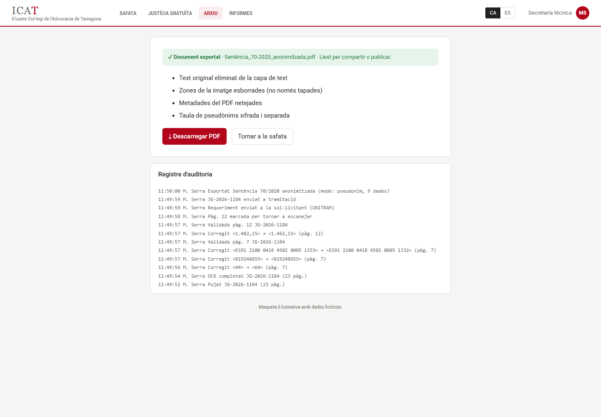

- **Ve**: antes de exportar, una confirmación **obligatoria** («He revisado el documento…»). Después, las garantías aplicadas y el registro de auditoría con cada acción de la sesión (subida, OCR, correcciones, validaciones, envío y exportación).
- **Cubre**: borrado real (texto, imagen y metadatos), confirmación humana y registro de quién ha visto, corregido y exportado cada documento.

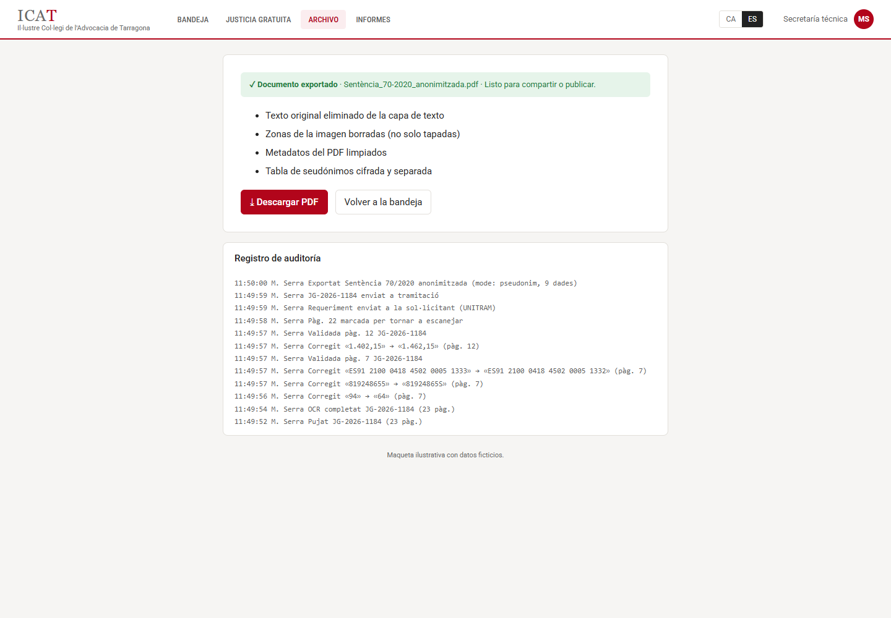

### 3.8 Archivo e informes (`#arxiu`, `#informes`)

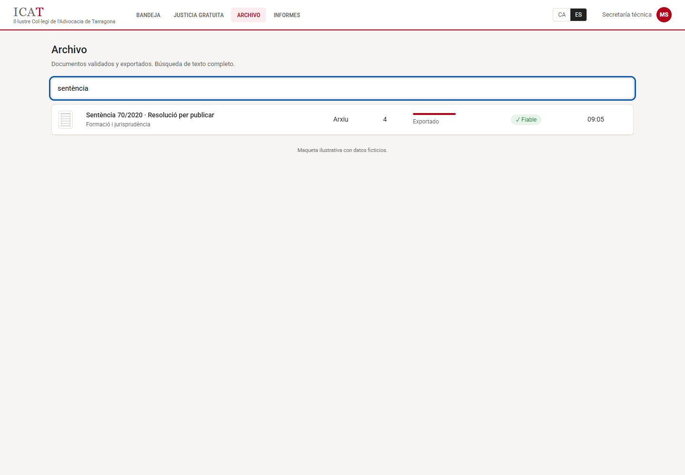

- Archivo con búsqueda de texto. Informes con cuatro indicadores de ejemplo (funcionalidad deseable, fase 2).

## 4. Sistema de diseño

Sigue la identidad visual actual del ICAT con un estilo institucional sobrio: mucho blanco, el granate solo para lo importante y una sola acción principal por pantalla.

| Token | Color | Uso |
|---|---|---|
| Primario | `#B2051B` | Botón principal, pestaña activa, marca |
| Texto | `#212121` | Texto general |
| Texto secundario | `#5E5E5E` | Fechas, ayudas, etiquetas (sustituye al `#A6A6A6` de la web, que no cumple contraste) |
| Fondo | `#F6F5F3` | Fondo de página |
| Fiable | `#1F7A3A` sobre `#E6F4EA` | Semáforo verde |
| Revisar | `#8A5A00` sobre `#FFF4D6` | Semáforo ámbar y lecturas distintas |
| Volver a escanear | `#B2051B` sobre `#FBEDEF` | Semáforo rojo y validaciones fallidas |
| Foco | `#0B5CAD` | Contorno de foco de teclado |

- **Tipografía**: Roboto para la interfaz, Roboto Condensed en mayúsculas para la navegación, Georgia para el texto de los documentos.
- **Accesibilidad (WCAG 2.2 AA)**: el color nunca es la única señal (el semáforo lleva icono y texto); el foco del teclado es visible; los avisos y los datos anonimizados son botones accesibles con teclado; las fichas se abren también con el foco; los objetivos de clic miden al menos 24 px.

## 5. Qué cubre de la propuesta

| Funcionalidad de la propuesta | Prioridad | Dónde se ve |
|---|---|---|
| Procesamiento 100 % local | Imprescindible | Acceso, bandeja |
| Interfaz en catalán y castellano | Imprescindible | Toda la maqueta |
| Bandeja con estado y semáforo por página | Imprescindible | Bandeja, transcripción |
| Revisión imagen/texto con dudas marcadas | Imprescindible | Revisión |
| Exportación a PDF | Imprescindible | Revisión (botón), exportación |
| Acceso con credenciales del Colegio y perfiles | Imprescindible | Acceso (perfiles: no simulados) |
| Registro de accesos y acciones | Imprescindible | Ficha del dato, exportación |
| Lista de comprobación de justicia gratuita | Importante | Justicia gratuita |
| Ficha de datos extraídos | Importante | Justicia gratuita |
| Importación desde la carpeta del escáner | Importante | Bandeja (texto de la zona de arrastre) |
| Búsqueda de texto completo | Importante | Bandeja, archivo |
| Anonimización con 6 formas y categorías | Propuesta § 6 | Anonimización |
| Panel de volumen y tiempos | Deseable | Informes |
| Firma con certificado ACA, integración con UNITRAM, resúmenes | Importante / deseable | **No incluido** |

## 6. Pasarla a Figma

1. En Figma, instala el plugin **html.to.design** (funciona en Figma web).
2. Importa cada ruta (`index.html#login`, `#safata`, …). Si el plugin pide una URL pública, usa su extensión de Chrome con la página abierta.
3. Cierra la guía de la demo (✕) antes de importar.
4. Enlaza las pantallas en el modo *Prototype* siguiendo el orden del § 3.

## 7. Comprobación automática

`maqueta/recorrido.py` recorre el flujo completo como un usuario, con Playwright sobre Edge:

```
pip install playwright
python maqueta/recorrido.py maqueta/index.html capturas
```

Comprueba que «Validar» y «Exportar» están bloqueados hasta cumplir sus condiciones, que la imagen marca el aviso señalado y que se salta a la página ilegible. Genera las capturas de este documento y falla si hay errores de JavaScript. Resultado actual: **0 errores**.

## 8. Limitaciones

- Es una simulación: no hay OCR ni anonimización reales. Los resultados de los motores están en el informe de Presidio y en el de PaddleOCR-VL.
- El estado no se guarda: recargar reinicia la demo.
- Diseñada para escritorio (1.440 px). La bandeja aún no está adaptada a tableta, como pide la propuesta.
- Los perfiles (secretaría, Comisión, colegiados) y la firma con ACA no están simulados.
