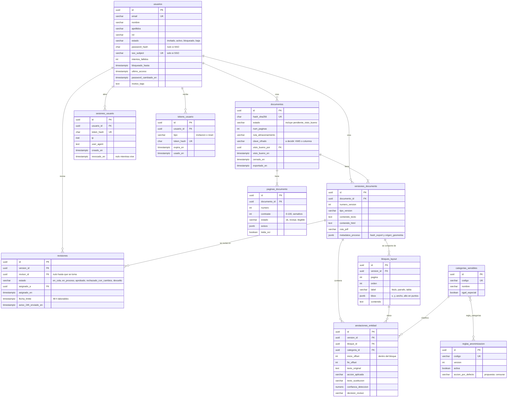

# 0010 · Modelo de datos: qué encaja del modelo de @Marina, qué sobra y qué falta

- **Estado**: Sustituida por [[0011-ajustes-al-modelo-de-marina]] (17/11/2026). @Marina respondió a los seis puntos y el modelo vigente es el suyo.
- **Fecha**: 2026-11-17
- **Autor**: @ia-opencode-ruben
- **Quién decide**: @Marina. La base de datos es suya y su modelo ([[Modelo de datos]]) manda; esto es una entrada para su decisión, no una alternativa.

## Contexto

El contrato y las reglas describen cosas que el esquema no tiene: autenticación con sesiones, bloques de layout con `bbox`, cola de revisión, semáforo por página y un hash del PDF. Son los bloqueantes B1, B3, B4, B5 y B8 de [[Coherencia]], y el detalle está en [`docs/pendientes.md`](../../docs/pendientes.md) §3.

Hoy las migraciones están ordenadas por *cuándo se escribió* cada tabla, no por *cuándo se necesita*. Eso da tres problemas: `usuarios` no aguanta el login, `bloques_layout` no existe aunque tres rutas la citan, y `revisiones` no cabe en una cola.

@Marina ha dibujado su propio modelo el 17/11. Está tal cual en [[Modelo de datos]], con la comparación punto por punto contra esta propuesta: lo que cierra, lo que deja abierto y los tres puntos donde las dos chocan (caducidad del expediente, dueño del hash del PDF y cola de revisión).

## Veredicto: el modelo de @Marina encaja

**Sí encaja y no hay que rehacerlo.** De las 13 tablas, 10 son iguales o mejores que las del esquema actual, y las 3 nuevas (`sesiones_usuario`, `tokens_usuario`, `bloques_layout`) son exactamente las que faltaban por B1 y B3. En varios sitios es más completo que esta propuesta: `requiere_visto_bueno` persistido, `eliminado` con borrado lógico, `es_actual` con índice parcial, trazabilidad por versión y geometría con el tamaño de página.

Solo hay **tres puntos que no encajan**, y los tres son locales:

| Punto | Por qué no encaja | Arreglo mínimo |
|---|---|---|
| `documentos.expira_en` «TTL OCR 24 h» | A-21 dice que **el expediente no caduca**; el TTL es de los ficheros temporales del OCR. Es la vuelta de B6, que se cerró el 17/11 | Quitar la columna, o renombrarla a algo que no esté en `documentos` |
| `auditoria.hash_actual` con `UNIQUE` | En una tabla particionada por mes, PostgreSQL exige que el `UNIQUE` incluya la clave de partición: tal cual, la migración falla. Y sin trigger que lo calcule, el hash no existe | Quitar el `UK` y dejar la cadena en `hash_anterior` (que ya está en V8) |
| `revisiones.revisor_id` **y** `asignado_a` | No se sabe cuál es «quien la tiene» y cuál «quien la cerró». Y `UNIQUE(version_id, numero_intento)` no implementa A-04, que prohíbe **dos revisiones abiertas por documento** | Una sola columna de responsable + índice parcial sobre `en_cola`/`en_proceso` |

Ninguno de los tres obliga a tocar el resto del modelo.

## Columnas que podrían sobrar

Sobre 154 columnas, estas 8 son las únicas que no se sostienen. No es «sobran 50»: es grasa localizada, y dos de las ocho son errores, no exceso.

| Columna | Qué pasa | Qué se pierde si se quita |
|---|---|---|
| `documentos.expira_en` | Contradice A-21 | Nada: el TTL de los temporales no vive en el expediente |
| `documentos.retencion_hasta` | Sale de la retención de `configuracion_sistema` + `creado_en`; nadie la lee | Nada hoy; si algún día se necesita, es una vista o una consulta |
| `documentos.cerrado_en` | Se deduce de la última transición y la fecha ya está en `auditoria` | Una consulta a `auditoria` para pintar la fecha de cierre |
| `auditoria.hash_actual` | Rompe el particionado y sin trigger está siempre a `NULL` | Nada mientras no haya trigger. Si se quiere integridad real: trigger y sin `UNIQUE` |
| `auditoria.entidad_clave` | Solo la usan los eventos de configuración | Un campo dentro de `detalle` |
| `bloques_layout.pagina_ancho/alto` | Repetidas en cada bloque (unas 1.100 filas por documento de 23 páginas) | Pasan a `paginas_documento`, una fila por página |
| `bloques_layout.forma` + `puntos` | Dos representaciones de la misma caja | Hasta que aparezca un bloque rotado, el `bbox` basta |
| `revisiones.revisor_id` o `asignado_a` | Una de las dos sobra | Hay que decidir cuál significa qué |

Lo que **no** sobra, aunque lo parezca: `eliminado_en` (el contrato tiene `DELETE /documents/{id}` y dice borrado lógico), `requiere_visto_bueno` (A-15 obliga a persistirlo), `es_actual`, `tiempo_revision_seg`, `prioridad`, `nivel_riesgo`, `ip_origen`, `motor_ocr`, `pipeline_version`, `confianza_layout_promedio` y `confianza`. Todas las devuelve una respuesta del contrato o las lee una regla; quitarlas obliga a cambiar contrato o reglas y ahí no se ahorra, se debe.

## Qué tomar de esta propuesta (si quiere)

Todo opcional y todo pequeño. La suya manda; esto solo tapa huecos que hoy no están en ningún modelo:

1. **`paginas_documento`** (`numero`, `ancho`, `alto`, `contraste`, `estado`, `avisos`): cierra B5, que hoy no está, y quita `pagina_ancho/alto` de los bloques.
2. **`usuarios.sso_subject`** si 0009 sale con SSO del ICAT: es el identificador del directorio, no el email.
3. **Marca del cifrado del original**: 0004 está **Aceptada** y el modelo solo tiene `ruta_almacenamiento`. Falta saber con qué clave se descifra (KMS o columna).
4. **`sesiones_usuario.user_agent`**: sin él no se puede enseñar «desde dónde estoy conectado».
5. **Índice parcial de A-04**: único sobre `(documento_id)` donde el estado sea `en_cola` o `en_proceso`.
6. **CHECK de `accion_aplicada`** con censurar, etiqueta e iniciales, y defecto censurar en vez de `tachado` (I1).
7. **Único parcial en `hash_sha256`** que excluya `estado = 'eliminado'`: si no, tras un borrado lógico el mismo PDF no se puede volver a subir.

## Si hay que rehacer algo, nos adaptamos

**El modelo es suyo y puede cambiarlo.** Si prefiere el `bbox` normalizado 0-1 en vez de píxeles con tamaño de página, si quiere `MAX(numero_version)` en lugar de `es_actual`, si prefiere otros nombres de tabla o partir `documentos` en dos: adelante. Cambiar el modelo es barato ahora; cambiar el contrato con código encima, no.

Lo que habría que tocar por nuestra parte, y es todo documentación:

| Si cambia | Se actualiza | Coste |
|---|---|---|
| Nombres de columna o de tabla | `docs/api/endpoints.md` (las respuestas que los devuelven) y `docs/export/pdf.md` | Un PR |
| La geometría (puntos, normalizado o píxeles) | `docs/export/pdf.md` § «Si el OCR no devuelve cajas» y el contrato de bloques | Un PR |
| El dueño del hash del PDF (B8) | A-18, el contrato §6 y `docs/export/pdf.md` §3 | Un PR |
| La cola de revisión (B4) | A-04, A-05 y el contrato §6 | Un PR |

Ninguno bloquea nada: son cuatro documentos, no código. Lo único que no se puede desde nuestro lado es **implementar una contradicción con una regla**. Si su modelo choca con A-04, A-15, A-20 o A-21, se cambia la regla con una decisión nueva —como se hizo con 0004— y después se implementa. Lo que no vale es tener las dos cosas.

## Lo que queda de este documento

Las secciones siguientes —la propuesta de tres migraciones, el cambio tabla a tabla y el diagrama— son **material de referencia**, no una alternativa a su modelo. Sirven para dos cosas: ver qué columnas pide cada regla, y tener un orden posible (`V13`, `V14`, `V15`) si le viene bien. Si su reparto es otro, mejor.

## Decisión

Se propone **no tocar retroactivamente V1-V12** y añadir tres migraciones nuevas, cada una con sus índices:

| # | Contenido | Depende de |
|---|---|---|
| `V13` | Identidad: `usuarios`, `tokens_usuario`, `sesiones_usuario` | [[0009-identidad]] |
| `V14` | Estructura: `bloques_layout` y `documentos.num_paginas` (más `paginas_documento` si se acepta) | nada |
| `V15` | Flujo y export: estados, visto bueno, `revisiones`, hash, seeds | [[0005-reglas-usuarios-y-aprobacion]] y [[0007-generacion-pdf-final]] |

El orden importa: `V14` se puede escribir **hoy** y es la que desbloquea OCR, PDF y semáforo. `V13` no se toca hasta que se cierre 0009, porque la mitad de sus columnas dependen de si hay SSO o contraseña.

## Qué cambia, tabla a tabla

### `usuarios` (V13)

Hoy: `email`, `nombre_completo`, `rol`, `activo`. El contrato pide nombre y apellidos por separado, login y una cuenta con estados.

- `estado` (`invitado | activo | bloqueado | baja`) **sustituye** a `activo`. Motivo: el contrato distingue invitación, bloqueo y baja irreversible, y `activo boolean` solo puede expresar dos de los cuatro.
- `password_hash`, `password_cambiado_en`, `intentos_fallidos`, `bloqueado_hasta`, `ultimo_acceso`, `motivo_baja`: los piden las reglas U-04, U-08, U-13 y el `429` del login.
- `sso_subject` UNIQUE **solo si** 0009 elige SSO. Es el identificador del directorio del ICAT, no el email.
- El índice `idx_usuarios_rol_activo` pasa a `(rol, estado)`: al quitar `activo` se cae.

### `tokens_usuario` y `sesiones_usuario` (V13)

Tablas nuevas. `tokens_usuario` para invitación y reset (`tipo`, `token_hash`, `expira_en`, `usado_en`); `sesiones_usuario` para las sesiones (`token_hash`, `creado_en`, `revocado_en`), con el tope de 3 y desalojo de la más antigua.

Por qué nuevas y no columnas en `usuarios`: un usuario tiene varias sesiones y varios tokens a la vez, y el token se guarda **hasheado**. Con SSO, `tokens_usuario` se queda solo para el reset del admin de emergencia.

Se guarda el hash, nunca el token: el acceso se valida contra `token_hash` y la sesión se revoca marcando `revocado_en`.

### `documentos` (V14 y V15)

- `num_paginas`: el contrato lo devuelve en tres respuestas y no existe como columna.
- CHECK de `estado`: falta `pendiente_visto_bueno`, que la regla A-15 ya usa. Sin ampliarlo, el flujo de doble firma no se puede guardar.
- `visto_bueno_por`, `visto_bueno_en` y `cerrado_en`: A-15 y A-19 los nombran.
- Marca del original cifrado (decisión 0004): `ruta_almacenamiento` ya sirve para la ruta; falta saber con qué clave se descifra (KMS o columna), y eso es parte de lo que hay que decidir.
- `hash_export` y `exportado_en`: **uno solo de los dos sitios**. El diseño del PDF los pone en `versiones_documento.metadatos_proceso`; A-18 y el contrato, en `documentos`. Se propone que el dueño sea la **versión** (el PDF es por versión, y al reabrir el hash anterior debe sobrevivir) y que `documentos` solo guarde `estado` y `exportado_en`.

### `bloques_layout` (V14, tabla nueva)

`version_id`, `pagina`, `orden`, `label`, `bbox` y `contenido`. Es la entrada del PDF final y la base de los offsets de las anotaciones.

Por qué: sin ella no se puede reconstruir la maquetación ni rellenar el `bbox` que pide `GET /documents/{id}/versions/{version}/blocks`. Y fija **una** base para los offsets: hoy `anotaciones_entidad` los cuenta sobre el texto completo y el contrato sobre `bloques_layout.contenido`. Se propone la segunda, con `bloque_id` en la anotación.

### `paginas_documento` (V14, tabla nueva)

`documento_id`, `numero`, `contraste`, `estado`, `avisos`, `leida_ocr`. Es el semáforo de calidad por página, que hoy no tiene ni modelo ni endpoint (B5).

### `anotaciones_entidad` (V15)

- `bloque_id` y offsets dentro del bloque (ver arriba).
- CHECK de `accion_aplicada`: faltan censurar, etiqueta e iniciales (I1). El defecto del sistema pasa de `tachado` a censurar, porque `tachado` estaba reservado a uso interno.
- Las columnas `bbox_x/y/ancho/alto` se quedan solo si la base de offsets no basta para pintar la marca; si `bloques_layout` guarda el `bbox`, son redundantes.

### `revisiones` (V15)

- `revisor_id` pasa a **nulo**: la revisión nace en cola sin dueño (A-05) y la toma quien la cierra.
- `estado` admite `en_cola`.
- `asignado_a`, `asignado_en`, `fecha_limite`, `aviso_24h_enviado_en`: A-05 y A-20 (48 h laborables con aviso a las 24 h).

### Seeds y configuración (V15)

- `categorias_sensibles`: `NUSS` deja de ser `rgpd_especial`; es un identificador, no un dato del art. 9, y hoy dispara doble firma en cualquier expediente que lo mencione.
- `configuracion_sistema`: fuera los motores OCR en cloud (contradice [[0001-ocr-local-paddleocr-vl]]), `preservar_formato_pdf = false` (contradice 0007), fuera el «timeout de revisión de 60 min» (el plazo es 48 h) y `version_esquema_bd` corregido.

### Lo que **no** cambia

- `auditoria`: `evento` + `detalle` JSONB aguantan login, SSO, reapertura y export sin tocar la tabla.
- `versiones_documento`: la cadena `original → ocr_texto → anonimizado_ia → revisado_humano → final_aprobado` sirve tal cual.
- `reglas_anonimizacion` y `regla_categorias`: solo el seed del defecto.
- No hay borrado ni renombrado de tablas: nada de lo existente se pierde.

## Diagrama propuesto



## Consecuencias

- Tres migraciones nuevas, ninguna destructiva. `V14` no espera a nadie; `V13` y `V15` esperan a 0009, 0005 y 0007.
- Los índices de V10 no se editan: se añaden en la migración que toca la columna (`idx_usuarios_rol_activo` en `V13`, los de `bloques_layout` y `paginas_documento` en `V14`).
- Si 0009 elige cuentas locales, `sesiones_usuario` y `tokens_usuario` son obligatorias; si elige SSO, `tokens_usuario` queda reducida al admin de emergencia.
- Si 0005 cambia las acciones de anonimización, el CHECK de `accion_aplicada` se abre en `V15` y no antes.
- `er-diagram.md` que cita `docs/architecture/README.md` no existe: este diagrama puede ser su punto de partida.

## Preguntas para @Marina

Solo quedan seis; las demás las ha contestado su propio modelo.

1. **Geometría**: píxeles + `pagina_ancho/alto` resuelve lo que preguntaba. ¿Se queda así también para `quad`/`poly`, o el `punto` se guarda aparte del `bbox`?
2. **`revisiones`**: ¿`revisor_id` es «quien la cerró» y `asignado_a` «quien la tiene», o sobra una?
3. **Tabla de páginas**: ¿entra `paginas_documento` (cierra B5 y quita dos columnas repetidas) o el semáforo se queda solo por bloque?
4. **Hash del PDF** (B8): ¿`documentos` o `versiones_documento`? Al reabrir un aprobado, ¿qué hash hay que conservar?
5. **`seudonimos`**: ¿se crea ahora o se retira la promesa de la maqueta? Es la única tabla que añade superficie de cifrado (I2).
6. **Clave del original cifrado**: ¿KMS o columna por documento? De eso depende si `documentos` necesita un campo más (0004 está Aceptada).

## Prompt para el agente de @Marina

Para que no tenga que reconstruir el contexto ni adivinar qué se le pide:

```text
Trabajas en el repositorio POC_Abogados (rama propia, PR contra main; la bóveda vive en vault/).

Contexto que tienes que leer antes de responder:
- vault/Proyecto/Modelo de datos.md — el modelo de @Marina. ES LA FUENTE DE VERDAD.
- vault/Decisiones/0010-modelo-de-datos.md — propuesta de backend, subordinada al modelo anterior.
- vault/Proyecto/Coherencia.md — bloqueantes B1-B8 e I1-I9.
- docs/reglas/aprobacion.md — A-04, A-15, A-20 y A-21.
- docs/api/endpoints.md §3-6 — lo que el contrato devuelve hoy.
- docs/architecture/migrations/V1-V12 — el esquema actual.
- Decisiones 0004 (original cifrado) y 0007 (PDF final).

Tarea:
1. Revisa los tres puntos que no encajan y las ocho columnas sobrantes de 0010. Para cada uno
   responde: se queda / se cambia / se quita, con el motivo en una línea y a quién afecta
   (contrato, regla o código). No des por buena la lista: si crees que una columna sí se usa,
   di dónde.
2. Propón la migración que falte con el modelo de Marina como base: SQL no destructivo, sin
   tocar V1-V12, con sus índices (incluido el parcial de A-04), y dime en qué orden se puede
   escribir sin esperar a nadie.
3. Contesta las preguntas abiertas de 0010: precisión de la geometría, tabla de seudónimos,
   citext o lower(email), dónde vive la clave del cifrado, y si la tabla de páginas entra o no.

Reglas del juego:
- No inventes columnas que no lea una regla o una respuesta del contrato. Si una columna no
  tiene lector, dilo.
- No borres ni renombres tablas existentes sin decirlo explícitamente y sin plan de datos.
- No cambies una regla para que encaje el modelo: si hay contradicción, propón una decisión
  nueva en vault/Decisiones/ y sigue.
- Nada de datos reales del ICAT, datos personales, credenciales ni tokens.
- Español. Cambios mínimos. Un PR con la migración y la actualización de la bóveda.

Entrega: la tabla de los once puntos resueltos, el SQL (o el diff de columnas si prefieres no
escribirlo todavía), las preguntas que no puedas cerrar tú, y qué necesitas de nosotros.
```
