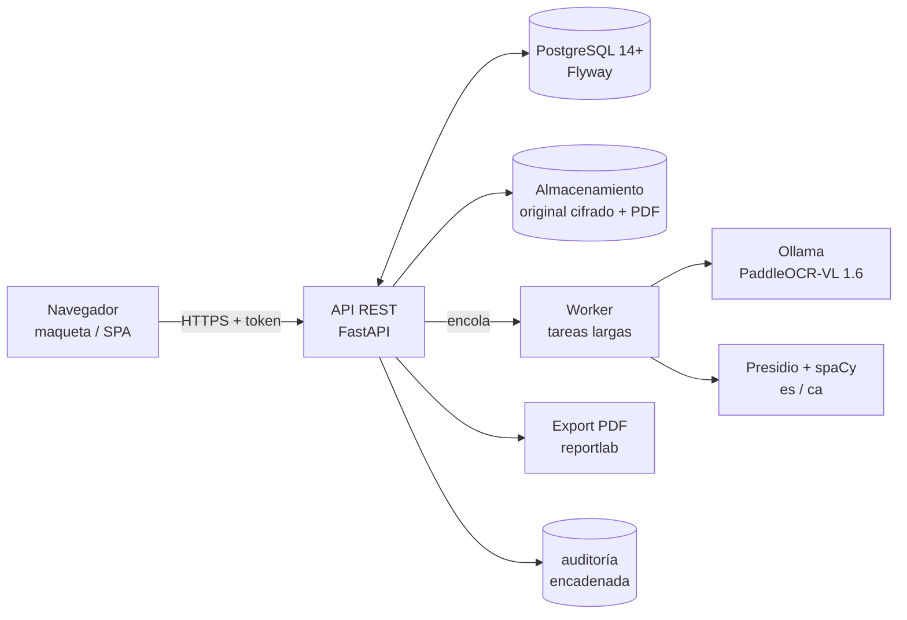
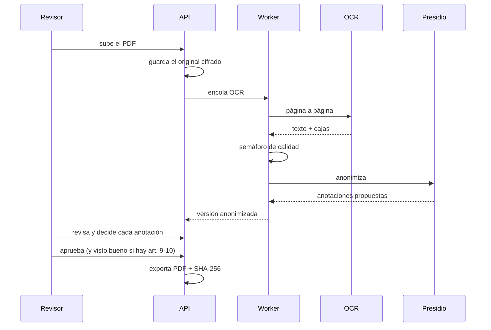

# Enfoque técnico

- **Para**: entrega del viernes 27/11/2026 (ver [[Equipo]])
- **Estado**: borrador para revisión · 17/11/2026
- **Autor**: @ia-opencode-ruben
- **Qué es**: la arquitectura del piloto y **el porqué de cada pieza**, con la alternativa que se descartó y lo que cuesta. No sustituye al detalle: el contrato está en [`docs/api/endpoints.md`](../../docs/api/endpoints.md), las reglas en [`docs/reglas/`](../../docs/reglas/) y el modelo de datos lo está cerrando @Marina en [[Modelo de datos]].

## 1. Qué construimos

Una herramienta que **se instala en el Colegio**, recibe los escaneos que ya llegan hoy y devuelve texto revisable y un PDF anonimizado. Tres frases que resumen todas las decisiones de abajo:

1. **Nada sale del Colegio.** Ni el OCR, ni la anonimización, ni el PDF pasan por un servicio en la nube.
2. **El original se guarda cifrado y no se toca.** Se anonimiza al construir la versión que se revisa y al exportar (decisión [[0004-anonimizacion-antes-o-despues-de-revision]]).
3. **La herramienta no decide.** Detecta, propone y marca dudas; la persona revisora confirma cada dato y la exportación exige que no quede ninguna pendiente.

## 2. Arquitectura

Tres procesos, cada uno con su motivo:

| Proceso | Qué hace | Por qué separado |
|---|---|---|
| **API** | Las 40 rutas del contrato: subir, listar, revisar, decidir, exportar | Responde en milisegundos; no puede quedarse colgada esperando a la GPU |
| **Worker** | OCR, layout y anonimización, que tardan segundos o minutos por documento | Una petición HTTP de 2 minutos es un timeout esperando a pasar |
| **Ollama** | Sirve el modelo de OCR por HTTP en la misma máquina | El modelo se carga una vez y atiende a todos; el backend no gestiona la GPU |

## 3. Las piezas, una por una

| Pieza | Elección | Por qué esta | Qué se descartó y por qué | Estado |
|---|---|---|---|---|
| **Base de datos** | PostgreSQL 14+ con migraciones Flyway | Necesitamos `UUID`, `JSONB`, `INET`, particiones e integridad referencial; el esquema cambia por PR y Flyway deja historial de cada cambio | **MongoDB**: los datos son relacionales (documento → versiones → bloques → anotaciones) y RGPD pide trazabilidad, no esquema libre. **SQLite**: no aguanta varios revisores a la vez | [[0002-postgresql]] (Propuesta) |
| **Backend** | Python 3.12 + FastAPI + SQL explícito | Las tres piezas caras del proyecto ya son Python: OCR, anonimización y PDF. Un solo runtime, un solo CI | **C# + ASP.NET Core**: obliga a un sidecar Python para Presidio y el PDF, un segundo runtime y un contrato interno HTTP, sin ahorrar nada medible: el cuello de botella es la GPU | [[0008-stack-backend]] (Propuesta) |
| **OCR** | PaddleOCR-VL 1.6 servido por Ollama, en local | ~2.750 páginas/hora con una RTX 3050 y ~1 % de error de carácter; DNI, importes y referencias exactos en escaneos limpios y malos | **OCR en la nube** (viola «todo local» y saca datos del Colegio). **Tesseract**: peor en tablas, sellos y manuscrito | [[0001-ocr-local-paddleocr-vl]] (Aceptada) |
| **Anonimización** | Presidio + spaCy `es_core_news_md` / `ca_core_news_md` | 100 % de los datos tapados en el corpus de ajuste (94,4 % en validación), 98,8 % de precisión y 65 ms/página; se configura sin desplegar | **LLM en la nube**: mismo problema de privacidad. **Solo regex**: no detecta nombres ni direcciones. **Modelo `lg`**: no mejora al `md` y ocupa 2,6 veces más | [[0006-presidio-anonimizacion-local]] (Propuesta) |
| **PDF final** | Reconstruir desde la estructura con `reportlab` | Un PDF de 100 páginas en menos de 1,5 s, sin GPU, y **sin ningún píxel del original**: no hay recorte que se pueda descolocar | **Repintar el escaneo**: los píxeles del original siguen dentro; una caja mal puesta deja el dato visible. **PyMuPDF** (AGPL): obligaría a abrir el código del producto | [[0007-generacion-pdf-final]] (Propuesta) |
| **Identidad** | SSO del ICAT + **un** admin local de emergencia | El SSO es el camino normal; la cuenta local existe solo para entrar si el proveedor falla o retira el permiso | **Solo SSO**: si cae el tenant, nadie puede entrar ni a consultar lo aprobado. **Solo local**: una contraseña más que mantener por persona y un SMTP | [[0009-identidad]] (Propuesta) |
| **Auditoría** | Tabla encadenada por hash, particionada por mes | Cada acción queda registrada con su anterior; el volumen crece sin degradar las consultas | **Logs de aplicación**: se rotan y se pierden; no sirven como prueba | V8 (hecho) |
| **Despliegue** | NVIDIA DGX Spark en el Colegio, Arm64 | 128 GB unificados: caben a la vez OCR, spaCy y PostgreSQL, sin repartir memoria | **Servidor cloud con GPU**: coste mensual y datos fuera. **CPU**: el OCR baja de 2.750 a ~260 páginas/hora | [[Servidor definitivo]] (equipo decidido, sin medir) |

## 4. El flujo, con sus tiempos

| Paso | Coste medido | Nota |
|---|---|---|
| Subir y guardar cifrado | segundos | Depende del tamaño del fichero |
| OCR | 1,3 s/página en paralelo ×4; ~2.750 pág/h | Con RTX 3050. Un PDF de 100 páginas, ~2 min |
| Semáforo de calidad | milisegundos | Contraste < 80 → volver a escanear; después, heurísticas de texto |
| Anonimizar | 65 ms/página | spaCy `md`, 339 MB de memoria |
| Revisión humana | **variable, es el cuello de botella real** | La herramienta no lo esconde: es el paso que da valor |
| Exportar | < 1,5 s cada 100 páginas | Sin GPU |

## 5. Lo que está medido y lo que no

Decir «funciona» sin distinguir estas dos columnas es cómo se pierden los proyectos:

| Dato | Valor | ¿Medido? |
|---|---|---|
| OCR con RTX 3050 | ~2.750 pág/h, 1,3 s/pág en paralelo | **Sí** |
| OCR solo CPU | ~100-260 pág/h | **Sí** (portátil y VM del servidor) |
| Precisión del OCR | ~1 % CER; fax 3,7 %; muy mala calidad 54 % **e inventa texto** | **Sí** |
| Anonimización | 100 % ajuste / 94,4 % validación, 98,8 % precisión, 65 ms/pág | **Sí** |
| Export PDF | < 1,5 s / 100 páginas | **Estimado** por coste por página |
| OCR en el DGX Spark | 4.000-6.000 pág/h | **No**: hay que repetir el banco allí |
| Documentos reales del Colegio | — | **No**: el corpus es sintético + BOE. Es la fase 0 del plan |
| Concurrencia (varios documentos a la vez) | — | **No** |

## 6. Seguridad y datos

| Qué | Cómo |
|---|---|
| Dónde se ejecuta | Servidor del Colegio, red propia; ni OCR ni anonimización en la nube |
| Original | Cifrado en reposo; se descifra solo para procesar (0004) |
| Texto que sale | Versión anonimizada; el PDF se reconstruye sin píxeles del original y sin sus metadatos |
| Acceso | Token opaco revocable (no JWT), Argon2id, máximo 3 sesiones, sin autoregistro, `401` que no revela si el email existe |
| Trazabilidad | Cada acción en `auditoria`, incluido el uso del admin de emergencia |
| Pendiente | Dónde vive la clave del cifrado (KMS o columna) y la marca por documento; es una de las preguntas abiertas del modelo |

## 7. Qué no está decidido

Y conviene decirlo antes de que lo pregunte el cliente:

| Abierto | Quién | Qué bloquea |
|---|---|---|
| [[0008-stack-backend]] | @Marina, @Kevin, @Alex | El primer endpoint |
| [[0009-identidad]] | @Kevin, @Marina, @Alex + registro OIDC del ICAT (1-2 semanas de terceros) | El alta de usuarios y la tabla de identidad |
| Modelo de datos ([[0010-modelo-de-datos]]) | @Marina | La migración `V13`-`V15` |
| Dueño del hash del PDF (B8) | @Rubén | El export idempotente |
| Frontend del piloto | sin dueño | La maqueta es HTML/CSS/JS sin framework; falta decidir si el piloto es esa maqueta conectada o una SPA |
| OCR síncrono o por página asíncrona (I5) | sin dueño | La forma de las rutas de OCR |
| Geometría del PDF por documento | ya decidido (capa de texto → layout → secuencial) | Falta medir qué trae el corpus real |

## 8. Alternativas descartadas, en una tabla

| Alternativa | Por qué no |
|---|---|
| OCR o LLM en la nube | Los documentos no pueden salir del Colegio; es un requisito del pliego, no una preferencia |
| Guardar solo el texto y tirar el original | Sin original no se puede comprobar qué decía ni repetir una detección mejor |
| Anonimizar sobre la imagen y tapar cajas | Los píxeles del original quedan dentro del PDF; no hay coordenadas por palabra, así que un fallo tapa de menos |
| PyMuPDF para leer el PDF | Licencia AGPL: obligaría a publicar el código del producto |
| JWT para las sesiones | No se puede revocar antes de que caduque; el contrato exige cerrar sesiones al cambiar contraseña o rol |
| ORM | El modelo usa `JSONB`, particiones, índices parciales y SQL de reporte: el ORM estorba más de lo que ahorra |
| Microservicios | Un Colegio, un servidor y una persona en backend: tres despliegues para el mismo trabajo |
| Word como salida | Fuera de alcance del piloto; el contrato exporta PDF |

## 9. Cómo se comprueba

Cada promesa de arriba tiene una prueba; si no la tiene, no es una promesa:

| Promesa | Cómo se comprueba |
|---|---|
| Nada sale del Colegio | El servidor no tiene salida a internet en el camino de OCR, anonimización y export |
| El PDF no filtra el original | Extraer el texto del PDF y comprobar que no aparece ningún `texto_original` confirmado |
| El export es idempotente | Dos ejecuciones con el mismo texto dan el mismo SHA-256 |
| No se exporta con dudas | Una anotación sin decisión devuelve error, no PDF |
| El OCR avisa cuando no sabe | Contraste < 80 antes, heurísticas después; medido sobre el corpus real en la fase 0 |
| La anonimización no se inventa datos | Precisión y cobertura medidas con corpus de validación aparte, no con el de ajuste |

El plan de fases y el alcance funcional están en [[Propuesta ICAT]]; los bloqueantes abiertos, con su impacto, en [[Coherencia]].
