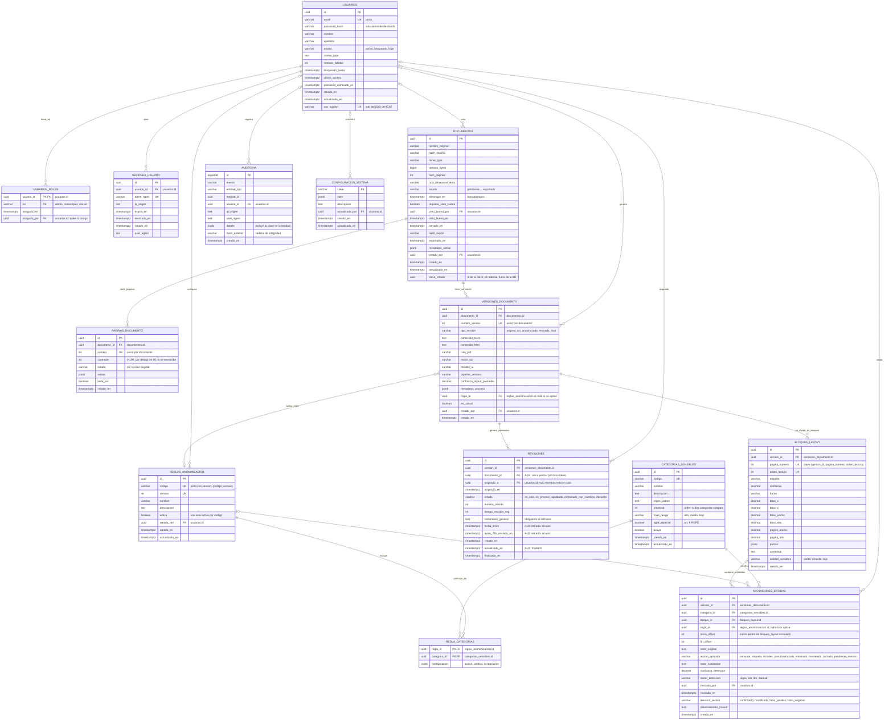

# Modelo de datos

- **Qué es**: el modelo objetivo del proyecto, alineado con **`Modelo-ER-POC-ICAT-v0.3` (24/11/2026)**: 14 entidades, 19 relaciones con nombre y 23 FK internas más una referencia externa a la tabla de claves.
- **Fuente**: el `.docx`, `.pdf` y `.pptx` de la v0.3. Sustituye al diagrama que @Marina dibujó el 17/11 y a la revisión del 18/11; ambos quedan en el historial de git.
- **Estado**: es el **modelo objetivo**. La edición actual de `V15` ya crea las **14 tablas** (incluidas `usuarios_roles`, `sesiones_usuario` y `regla_categorias`, [[0015-identidad-en-v15]]) y casi todas las columnas de aquí; quedan las diferencias que se listan en «Lo que sigue abierto».
- **Los bloqueantes** se citan por su ID de [[Coherencia]] (B1-B8, I1-I9) y las reglas por su código (`docs/reglas/`). B1, B3 y B8 están cerrados; B5 tiene lector; I2 sigue abierta.

## Diagrama

## Qué cambia respecto a la revisión anterior de este diagrama (18/11)

| Bloque | Cambio |
|---|---|
| Relaciones | Las tres relaciones llamadas `tiene` pasan a 19 nombres únicos en `snake_case`: `tiene_rol`, `tiene_paginas`, `tiene_versiones`, etc. `aplica_regla` se escribe `N : (0..1)` |
| `USUARIOS` | Vuelven `intentos_fallidos`, `bloqueado_hasta`, `ultimo_acceso` y `password_cambiado_en`; sale `eliminado_en`; `password_hash` es `varchar` y `nombre`/`apellidos` van separados |
| `USUARIOS_ROLES` | Gana `otorgado_en` y `otorgado_por` (auto-referencia); los tres roles son `admin`, `transcriptor` y `revisor` |
| `SESIONES_USUARIO` | La v0.3 no incluye `ultimo_uso_en` (que sí añade `V15`); conserva `expira_en`, `revocado_en` y `user_agent` |
| `DOCUMENTOS` | Vuelve `hash_export`; la v0.3 no documenta el único parcial de `hash_sha256` por creador |
| `REVISIONES` | `documento_id` y `actualizado_en` pasan aquí desde `ANOTACIONES_ENTIDAD`; el parcial de A-04 es **por documento**, no por versión |
| `ANOTACIONES_ENTIDAD` | Salen `documento_id` y `actualizado_en`; los offsets cuentan dentro de `bloques_layout.contenido`, como dice la v0.3 |
| `REGLAS_ANONIMIZACION` y `REGLA_CATEGORIAS` | `codigo` y `version` forman el único `(codigo, version)`; la tabla puente tiene PK compuesta `(regla_id, categoria_id)` |
| `AUDITORIA` | `hash_anterior` se documenta como `varchar`, no `char(64)` |

## Dos correcciones aplicadas a la v0.3

La v0.3 arrastra dos errores que **no** se han copiado al diagrama:

1. Pone `documento_id` y `actualizado_en` en `ANOTACIONES_ENTIDAD`; son columnas de `REVISIONES` (índice de A-04 y `If-Match` de A-23, según `docs/reglas/aprobacion.md`).
2. Describe el índice parcial de A-04 «por versión»; la regla aceptada es **una revisión abierta por documento**.

## Lo que sigue abierto

- **Desfase con el SQL (E-53)**: la edición actual de `V15` ya trae las 14 tablas y casi todas las columnas, pero no tiene `intentos_fallidos`, `bloqueado_hasta`, `ultimo_acceso` ni `password_cambiado_en` en `usuarios`, ni `otorgado_en`/`otorgado_por` en `usuarios_roles`. Sí tiene, en cambio, `ultimo_uso_en` en `sesiones_usuario`, que la v0.3 no contempla.
- **`hash_export` (E-53)**: la v0.3 lo pone en `DOCUMENTOS` y da B8 por abierto. B8 está cerrado desde el 19/11: el hash es de la versión, en `versiones_documento.metadatos_proceso->>'hash_export'`. El diagrama recoge la columna por fidelidad a la v0.3, pero manda el acuerdo del equipo.
- **Offsets**: resueltos el 25/11 (B3, E-21). La v0.3 y la edición actual de `V15` coinciden: cuentan dentro de `bloques_layout.contenido` y `bloque_id` lleva FK compuesta por versión (E-25).
- **A-20**: la v0.3 la marca «en pausa»; está **retirada** desde el 18/11. `fecha_limite` y `aviso_24h_enviado_en` siguen en el SQL sin uso (E-42).
- **0012 en la v0.3 (E-53)**: su §5 dice que la propuesta sustituye `usuarios_roles` por una columna `roles`; está al revés. @Marina decidió el 18/11 que los roles van en tabla, y [[0015-identidad-en-v15]] lo implementa.
- **Identidad**: [[0009-identidad]] y la parte de [[0012-identidad-y-roles]] que afecta al modelo están implementadas al final de `V15` ([[0015-identidad-en-v15]]). Falta recrear la base de desarrollo y validar vistas, triggers y diccionario; el registro OIDC del ICAT sigue pendiente (B2).
- **Tabla de seudónimos (I2, E-38)**: `pseudonimizado` guarda `texto_sustitucion` en la anotación, así que la misma persona puede salir con dos seudónimos distintos en el mismo documento.
- **Geometría legacy (E-51)**: `anotaciones_entidad` conserva `pagina_numero` y `bbox_*`, que no aparecen en la v0.3. Queda decidir si se guardan como respaldo o se eliminan con plan de datos.

## Qué queda del debate con 0010

[[0010-modelo-de-datos]] proponía bajar el modelo en tres migraciones (`V13` identidad, `V14` estructura, `V15` flujo). `V14` y `V15` están escritas; `V13` se descartó al cerrar la BD el 19/11 y la identidad se añadió al final de `V15` ([[0015-identidad-en-v15]]). Su diagrama se retiró el 18/11 para dejar **un solo diagrama**, este, que ahora sigue la v0.3 del 24/11.

Lo que 0010 acertó y se ha quedado: `bloques_layout` como base de los offsets, `paginas_documento` con semáforo por página, la cola de revisión con `asignado_a`, las relaciones de reglas y un solo dueño del hash del PDF (B8).

**Fuentes**: `Modelo-ER-POC-ICAT-v0.3.docx`, `.pdf` y `.pptx` (24/11/2026, documentos de revisión); [[0010-modelo-de-datos]], [[0011-ajustes-al-modelo-de-marina]], [[0012-identidad-y-roles]] y [[0015-identidad-en-v15]].
