# Modelo de datos

- **Qué es**: el modelo objetivo que ha dibujado @Marina (17/11/2026). El diagrama está copiado **tal cual**, sin corregir.
- **No es el esquema actual**: en `docs/architecture/migrations/` lo último es `V12`. Nada de esto está implementado.
- **Se compara con**: [[0010-modelo-de-datos]], que propone bajar el modelo en tres migraciones (`V13` identidad, `V14` estructura, `V15` flujo).
- **Los bloqueantes** se citan por su ID de [[Coherencia]] (B1-B8, I1-I9) y las reglas por su código (`docs/reglas/aprobacion.md`).

## Diagrama

```mermaid
erDiagram
    USUARIOS {
        uuid id PK
        varchar email UK "UNIQUE lower(email)"
        varchar password_hash "Argon2id, nunca texto plano"
        varchar nombre
        varchar apellidos
        varchar rol "transcriptor|revisor|admin|supervisor"
        varchar estado "invitado|activo|bloqueado|baja"
        text motivo_baja "NULL salvo estado=baja"
        int intentos_fallidos "para el 429 del login"
        timestamptz bloqueado_hasta
        timestamptz ultimo_acceso
        timestamptz password_cambiado_en "U-13: auditoría cambio pwd"
        timestamptz creado_en
        timestamptz actualizado_en
    }
 
    TOKENS_USUARIO {
        uuid id PK
        uuid usuario_id FK "usuarios.id"
        varchar tipo "invitacion|reset"
        varchar token_hash UK "SHA-256 token opaco"
        timestamptz expira_en
        timestamptz usado_en "NULL=pendiente, timestamp=consumido"
        timestamptz creado_en
    }
 
    SESIONES_USUARIO {
        uuid id PK
        uuid usuario_id FK
        varchar token_hash UK
        inet ip_origen
        timestamptz expira_en
        timestamptz revocado_en
        timestamptz creado_en "U-17: orden antigüedad para revocar la más vieja"
    }
 
    DOCUMENTOS {
        uuid id PK
        varchar nombre_original
        varchar hash_sha256 "UNIQUE(creado_por, hash_sha256)"
        varchar mime_type
        bigint tamano_bytes
        int num_paginas
        varchar ruta_almacenamiento
        varchar estado "pendiente|ocr_procesando|ocr_completado|anonimizando|en_revision|aprobado|rechazado|pendiente_visto_bueno|exportado|eliminado"
        timestamptz expira_en "TTL sesión OCR (24h) - A-21"
        timestamptz retencion_hasta "Retención legal"
        timestamptz eliminado_en "Borrado lógico"
        boolean requiere_visto_bueno "A-15: persistido al cerrar revisión"
        uuid visto_bueno_por FK "usuarios.id - supervisor"
        timestamptz visto_bueno_en
        timestamptz cerrado_en "A-19: congelación tras aprobado"
        varchar hash_export "SHA-256 PDF exportado - A-18"
        timestamptz exportado_en
        jsonb metadatos_extras
        uuid creado_por FK
        timestamptz creado_en
        timestamptz actualizado_en
    }
 
    VERSIONES_DOCUMENTO {
        uuid id PK
        uuid documento_id FK "UNIQUE(documento_id, numero_version)"
        int numero_version
        varchar tipo_version "original|ocr_texto|anonimizado_ia|revisado_humano|final_aprobado"
        text contenido_texto
        text contenido_html
        varchar ruta_pdf
        varchar motor_ocr "paddleocr-vl"
        varchar modelo_ia "presidio-es|spacy-es-lg|custom-ner-v1"
        varchar pipeline_version "PaddleOCR-VL v1.6"
        decimal confianza_layout_promedio "media score detector 0..1"
        jsonb metadatos_proceso "backend,params,tiempo,hardware,num_ctx,temperature,num_parallel"
        uuid regla_id FK "regla aplicada, nullable"
        boolean es_actual "UNIQUE(documento_id) WHERE es_actual"
        uuid creado_por FK
        timestamptz creado_en
    }
 
    BLOQUES_LAYOUT {
        uuid id PK
        uuid version_id FK "UNIQUE(version_id, pagina_numero, orden_lectura)"
        int pagina_numero
        int orden_lectura "orden lectura detector"
        varchar etiqueta "text|table|doc_title|paragraph_title|image|seal|header|footer..."
        decimal confianza "score detector 0..1"
        varchar forma "rect|quad|poly"
        decimal bbox_x "pixeles página renderizada"
        decimal bbox_y
        decimal bbox_ancho
        decimal bbox_alto
        decimal pagina_ancho "para escalar al visor"
        decimal pagina_alto
        jsonb puntos "vértices [[x,y],...] para quad/poly"
        text contenido "markdown reconocido del bloque"
        varchar calidad_semaforo "verde|amarillo|rojo - POC OCR §8"
        timestamptz creado_en
    }
 
    REGLAS_ANONIMIZACION {
        uuid id PK
        varchar codigo "UNIQUE(codigo, version)"
        int version
        varchar nombre
        text descripcion
        boolean activa "UNIQUE(codigo) WHERE activa"
        uuid creado_por FK
        timestamptz creado_en
        timestamptz actualizado_en
    }
 
    REGLA_CATEGORIAS {
        uuid regla_id PK, FK
        uuid categoria_id PK, FK
        jsonb configuracion "accion,umbral,excepciones por par regla-categoría"
    }
 
    CATEGORIAS_SENSIBLES {
        uuid id PK
        varchar codigo UK "DNI_NIE, PASAPORTE, NOMBRE_APELLIDOS, EMAIL, TELEFONO, DIRECCION, IBAN, MATRICULA, NUM_EXPEDIENTE, IMPORTE, FECHA_JURIDICA, REFERENCIA_JURIDICA, TABLA_DATOS, SALUD, MENORES, VIOLENCIA, DISCAPACIDAD, CONDENAS, ORIGEN_RACIAL, RELIGION, SINDICATO, ORIENTACION_SEXUAL, BIOMETRICOS, GENETICOS"
        varchar nombre
        text descripcion
        text regex_patron
        int prioridad "orden aplicación si solapan"
        varchar nivel_riesgo "alto|medio|bajo"
        boolean rgpd_especial "TRUE = Art.9 RGPD (salud, menores, violencia, discapacidad, condenas, origen, religión, sindicato, orientación, biométricos, genéticos) - A-15"
        boolean activa
        timestamptz creado_en
        timestamptz actualizado_en
    }
 
    ANOTACIONES_ENTIDAD {
        uuid id PK
        uuid version_id FK
        uuid categoria_id FK
        uuid bloque_id FK "bloque layout donde aparece"
        uuid regla_id FK "regla que la generó, nullable"
        int inicio_offset "relativo al texto del bloque"
        int fin_offset
        text texto_original
        varchar accion_aplicada "tachado|pseudonimizado|eliminado|mantenido|pendiente_revision"
        text texto_sustitucion
        decimal confianza_deteccion "score anonimizador 0..1"
        varchar motor_deteccion "regex|ner|llm|manual"
        uuid revisado_por FK
        timestamptz revisado_en
        varchar decision_revisor "confirmado|modificado|falso_positivo|falso_negativo"
        text observaciones_revisor
        timestamptz creado_en
    }
 
    REVISIONES {
        uuid id PK
        uuid version_id FK "UNIQUE(version_id, numero_intento)"
        uuid revisor_id FK
        uuid asignado_a FK "NULL en 'en_cola' - A-05"
        timestamptz asignado_en "A-05"
        varchar estado "en_cola|en_proceso|aprobado|rechazado_con_cambios|devuelto"
        int numero_intento
        int tiempo_revision_seg
        text comentario_general "obligatorio en rechazado_con_cambios/devuelto - A-13"
        timestamptz fecha_limite "A-20: 48h laborables desde creación"
        timestamptz aviso_24h_enviado_en "A-20"
        timestamptz creado_en
        timestamptz actualizado_en "A-23: If-Match concurrencia optimista"
        timestamptz finalizado_en
    }
 
    AUDITORIA {
        bigserial id PK
        varchar evento "DOCUMENTO_SUBIDO, DOCUMENTO_ESTADO_CAMBIO, DOCUMENTO_ELIMINADO, VERSION_CREADA, VERSION_MARCADA_ACTUAL, BLOQUE_LAYOUT_CREADO, ENTIDAD_DETECTADA, ENTIDAD_MODIFICADA_MANUAL, REVISION_INICIADA, REVISION_CLAIM, REVISION_ASSIGN, REVISION_APROBADA, REVISION_RECHAZADA, REVISION_REOPEN, REVISION_ESTADO_CAMBIO, VISTO_BUENO, EXPORT, REGLA_CREADA, REGLA_MODIFICADA, REGLA_CATEGORIA_AGREGADA, REGLA_CATEGORIA_ELIMINADA, CATEGORIA_CREADA, CATEGORIA_MODIFICADA, USUARIO_CREADO, USUARIO_MODIFICADO, SESION_CREADA, SESION_REVOCADA, SESION_REVOCADA_LOGIN, SESION_REVOCADA_PWD_CHANGE, SESION_REVOCADA_ROL_CHANGE, SESION_REVOCADA_ADMIN, SESION_REVOCADA_LIMIT, TOKEN_CONSUMIDO, CONFIG_CREADA, CONFIG_MODIFICADA"
        varchar entidad_tipo "documento|version|bloque|anotacion|revision|usuario|regla|config|token"
        uuid entidad_id "nullable, polimórfico"
        text entidad_clave "para CONFIGURACION_SISTEMA"
        uuid usuario_id FK
        inet ip_origen
        text user_agent
        jsonb detalle "{antes, después, parámetros, contexto}"
        varchar hash_anterior
        varchar hash_actual UK "cadena integridad: SHA256(this_row + hash_anterior)"
        timestamptz creado_en
    }
 
    CONFIGURACION_SISTEMA {
        varchar clave PK
        jsonb valor
        text descripcion
        uuid actualizado_por FK
        timestamptz creado_en
        timestamptz actualizado_en
    }
 
    USUARIOS ||--o{ TOKENS_USUARIO : "tiene tokens"
    USUARIOS ||--o{ SESIONES_USUARIO : "abre"
    USUARIOS ||--o{ DOCUMENTOS : "crea"
    USUARIOS ||--o{ VERSIONES_DOCUMENTO : "genera"
    USUARIOS ||--o{ REGLAS_ANONIMIZACION : "configura"
    USUARIOS ||--o{ REVISIONES : "revisa (revisor_id)"
    USUARIOS ||--o{ REVISIONES : "asignado (asignado_a)"
    USUARIOS ||--o{ ANOTACIONES_ENTIDAD : "valida"
    USUARIOS ||--o{ AUDITORIA : "registra"
    USUARIOS ||--o{ CONFIGURACION_SISTEMA : "actualiza"
 
    DOCUMENTOS ||--o{ VERSIONES_DOCUMENTO : "tiene versiones"
    VERSIONES_DOCUMENTO ||--o{ BLOQUES_LAYOUT : "se divide en bloques"
    BLOQUES_LAYOUT ||--o{ ANOTACIONES_ENTIDAD : "contiene entidades"
    VERSIONES_DOCUMENTO ||--o{ REVISIONES : "genera revisiones"
    VERSIONES_DOCUMENTO }o--o| REGLAS_ANONIMIZACION : "aplica regla"
 
    REGLAS_ANONIMIZACION ||--o{ REGLA_CATEGORIAS : "incluye"
    CATEGORIAS_SENSIBLES ||--o{ REGLA_CATEGORIAS : "participa en"
    CATEGORIAS_SENSIBLES ||--o{ ANOTACIONES_ENTIDAD : "clasifica"
    REGLAS_ANONIMIZACION ||--o{ ANOTACIONES_ENTIDAD : "produce" 
```

## Diferencias con 0010

Las dos propuestas llegan al mismo sitio en lo importante: identidad con `estado` y sesiones, `bloques_layout` como base de los offsets, cola de revisión, doble firma en `documentos` y una sola base de anotaciones. Las diferencias son de tres tipos: lo que Marina cierra y 0010 dejaba abierto, lo que 0010 arreglaba y el diagrama vuelve a abrir, y lo que no está en ninguno de los dos.

### 1. Lo que Marina cierra (y 0010 no tenía)

| Qué | Por qué importa |
|---|---|
| `documentos.estado` con `pendiente_visto_bueno` **y** `eliminado` | El valor que A-15 ya usa entra en el CHECK. 0010 solo añadía el primero; el borrado lógico no estaba. |
| `requiere_visto_bueno` (booleano persistido) | A-15 dice literalmente que se **persiste** al cerrar la revisión. 0010 lo dejaba implícito en las anotaciones: recalcularlo en cada lectura cambia la firma si alguien toca una categoría después. |
| `eliminado_en` + `retencion_hasta` | Borrado lógico con retención legal. Ninguno de los dos lo pedía el contrato, pero sin `eliminado_en` no hay forma de distinguir «rechazado» de «borrado». |
| `versiones_documento.es_actual` con único parcial | El contrato devuelve «la versión actual» en tres sitios y no había cómo saber cuál es. 0010 lo resolvía con `numero_version` máximo; el índice parcial es mejor. |
| `versiones_documento.regla_id`, `motor_ocr`, `modelo_ia`, `pipeline_version`, `confianza_layout_promedio` | Trazabilidad de con qué se generó cada versión. 0010 lo metía todo en `metadatos_proceso`; aquí lo dudoso sigue en JSON y lo consultable es columna. |
| `bloques_layout` con `forma` (`rect|quad|poly`), `puntos`, `confianza` y `pagina_ancho/alto` | Resuelve la pregunta 1 de 0010 mejor que las dos opciones que planteaba: el `bbox` va en píxeles **y** se guarda el tamaño de página con el que se midió, así que se escala al visor sin perder precisión y sobrevive a un cambio de render. |
| `calidad_semaforo` por bloque | El semáforo del POC OCR es por bloque, no solo por página. 0010 lo ponía únicamente por página. |
| `anotaciones_entidad.motor_deteccion`, `revisado_por/en`, `observaciones_revisor` | Permite medir aciertos por motor y guardar la decisión del revisor junto a la anotación. |
| `auditoria.entidad_clave`, `hash_anterior` + `hash_actual` | Cadena de integridad de la auditoría y clave para eventos sin UUID (configuración). 0010 decía que `auditoria` no cambiaba. |
| `hash_sha256` UNIQUE **por `creado_por`** | Dos personas pueden subir el mismo PDF sin chocar. El esquema actual lo tiene único global. |

### 2. Lo que 0010 arreglaba y el diagrama vuelve a abrir

| Qué | Consecuencia |
|---|---|
| **`documentos.expira_en` «TTL sesión OCR (24h) - A-21»** | A-21 dice lo contrario: **el expediente no caduca**, y el TTL es solo de los ficheros temporales del OCR. Es la vuelta de B6, que se dio por resuelto el 17/11. O sobra la columna, o el comentario miente; tal como está, quien implemente A-21 la usará para devolver `404` y matará el export que llega días después. |
| **`hash_export` en `documentos`** | Resuelve B8, pero al revés de lo que proponen 0007 y `docs/export/pdf.md`: el PDF es **por versión**, y al reabrir un aprobado el hash anterior se pierde si el dueño es el documento. B8 sigue siendo una decisión abierta; esto es una de las dos opciones, no la cerrada. |
| **`accion_aplicada` con las 5 acciones de siempre** | I1 intacto: faltan censurar, etiqueta e iniciales. Y el defecto del sistema sigue siendo `tachado` (V12), que la propuesta reserva a uso interno. |
| **`revisiones` con `revisor_id` y `asignado_a` a la vez** | B4 a medias: el diagrama no dice cuál es cuál. Si `revisor_id` es «quien la cerró» y `asignado_a` «quien la tiene», se puede; si no, uno de los dos sobra. Además `UNIQUE(version_id, numero_intento)` no implementa A-04: lo que A-04 prohíbe es **dos revisiones abiertas por documento**, y eso pide un índice parcial sobre `en_cola`/`en_proceso`. |
| **`sesiones_usuario` sin `user_agent`** | La auditoría sí lo guarda, la sesión no. Sin él no se puede enseñar «desde dónde estoy conectado» ni distinguir una sesión robada de la del usuario. |
| **`usuarios` sin `sso_subject`** | Si 0009 sale con SSO del ICAT, falta la columna que enlaza con el directorio. 0010 la dejaba condicionada a 0009 en `V13`. |

### 3. Lo que no está en ninguno de los dos

| Qué | Estado |
|---|---|
| **Tabla de páginas** (`contraste`, `estado`, `avisos`, `leida_ocr`) | No existe. B5 queda a medias: hay semáforo por bloque, no el contraste por página que decide «volver a escanear» antes del OCR. `documentos.num_paginas` sí está. |
| **`clave_cifrado` / marca del original cifrado** | La decisión 0004 está **Aceptada** (original cifrado) y el modelo solo tiene `ruta_almacenamiento`. No hay dónde anotar con qué clave se descifra. Era la pregunta 4 de 0010 y sigue sin respuesta. |
| **Tabla de seudónimos** | `pseudonimizado` guarda `texto_sustitucion` en la anotación, así que la misma persona puede salir con dos seudónimos distintos en el mismo documento. I2 sigue abierto. |
| **NUSS en `rgpd_especial`** | El comentario de `categorias_sensibles` ya lo excluye (lista solo art. 9-10), pero el seed `V11` no se ve en un diagrama. Si el seed no se corrige, NUSS sigue disparando doble firma. H8. |
| **Seeds de `configuracion_sistema`** | El diagrama no los muestra: siguen los motores OCR en cloud, `preservar_formato_pdf = false` y el timeout de revisión de 60 min que contradicen 0001 y 0007. |

### 4. Diferencias de forma, sin consecuencia

- `bloques_layout.pagina_numero` / `etiqueta` frente a `pagina` / `label` de 0010: el nombre en castellano es mejor, el resto igual.
- 0010 proponía `bbox` en JSON; aquí son cuatro `decimal` consultables. Mejor para filtrar por zona.
- 0010 metía el hash del export en `metadatos_proceso` de la versión; aquí es columna en `documentos`. Es la diferencia de B8, no de estilo.
- `anotaciones_entidad` ya no lleva `bbox_x/y/ancho/alto`: la posición sale del bloque. Las dos propuestas coinciden.

## Qué falta para bajarlo a migraciones

1. **Decidir B8** (hash en `documentos` o en la versión). El diagrama ya votó por `documentos`; 0007 y el diseño del PDF votan por la versión.
2. **Quitar o justificar `documentos.expira_en`**. Si se queda, A-21 hay que reescribirla y B6 vuelve a estar abierto.
3. **Cerrar B4**: qué significa cada una de las dos columnas de `revisiones`, y el índice parcial de A-04.
4. **`paginas_documento`**: entra en la misma migración que `bloques_layout` (es `V14` en 0010) o se deja fuera y B5 no se cierra.
5. **El CHECK de `accion_aplicada`** y el defecto de V12: es un `ALTER` de una línea, pero sin él I1 sigue abierto.
6. **`sso_subject`** depende de [[0009-identidad]]; el resto de `usuarios` no.

El reparto en `V13`/`V14`/`V15` de [[0010-modelo-de-datos]] sigue sirviendo, con un cambio: `V14` sería solo `bloques_layout` + `num_paginas` mientras no se decida la tabla de páginas.
