# Modelo de datos

- **Qué es**: el modelo objetivo del proyecto, con el diagrama **corregido el 18/11/2026**. Sustituye al que dibujó @Marina el 17/11, que queda en el historial de git.
- **Qué aplica**: lo **aceptado** en [[0011-ajustes-al-modelo-de-marina]] (`V14` y `V15`) y la identidad **aceptada** en [[0012-identidad-y-roles]]: roles en tabla `usuarios_roles` (decisión de @Marina, 18/11), `estado`, `sso_subject` y sesión propia en `sesiones_usuario`.
- **No es el esquema actual**: en `docs/architecture/migrations/` lo último es `V15`. `V13` no está escrita.
- **Los bloqueantes** se citan por su ID de [[Coherencia]] (B1-B8, I1-I9) y las reglas por su código (`docs/reglas/`).

## Diagrama

```mermaid
erDiagram
    USUARIOS {
        uuid id PK
        varchar email UK "UNIQUE lower(email)"
        text password_hash "solo admin de desarrollo; nulo con SSO"
        varchar nombre
        varchar apellidos
        varchar estado "activo, bloqueado, baja"
        text motivo_baja "NULL salvo estado=baja"
        varchar sso_subject UK "sub del ICAT; nulo en el admin local"
        timestamptz eliminado_en "U-08: baja definitiva"
        timestamptz creado_en
        timestamptz actualizado_en
    }

    USUARIOS_ROLES {
        uuid usuario_id PK, FK "usuarios.id"
        varchar rol PK "transcriptor, revisor, admin"
    }

    SESIONES_USUARIO {
        uuid id PK
        uuid usuario_id FK
        varchar token_hash UK "SHA-256 del token opaco"
        inet ip_origen
        text user_agent
        timestamptz expira_en "1 h deslizante"
        timestamptz ultimo_uso_en "renovacion de la sesion"
        timestamptz revocado_en "logout o revocacion"
        timestamptz creado_en "tope duro de 12 h"
    }

    DOCUMENTOS {
        uuid id PK
        varchar nombre_original
        varchar hash_sha256 "UNIQUE(creado_por, hash_sha256) parcial"
        varchar mime_type
        bigint tamano_bytes
        int num_paginas
        varchar ruta_almacenamiento
        varchar clave_cifrado "id de la KEK; el material, fuera de la BD"
        varchar estado "pendiente, ocr_procesando, ocr_completado, anonimizando, en_revision, aprobado, rechazado, pendiente_visto_bueno, exportado, eliminado"
        timestamptz eliminado_en "borrado logico"
        boolean requiere_visto_bueno "A-15 en pausa: hoy siempre false"
        uuid visto_bueno_por FK "usuarios.id - revisor"
        timestamptz visto_bueno_en
        timestamptz cerrado_en "A-19: congelacion tras aprobado"
        timestamptz exportado_en
        jsonb metadatos_extras
        uuid creado_por FK
        timestamptz creado_en
        timestamptz actualizado_en
    }

    VERSIONES_DOCUMENTO {
        uuid id PK
        uuid documento_id FK "UNIQUE(documento_id, numero_version)"
        int numero_version
        varchar tipo_version "original, ocr_texto, anonimizado_ia, revisado_humano, final_aprobado"
        text contenido_texto
        text contenido_html
        varchar ruta_pdf
        varchar motor_ocr "paddleocr-vl"
        varchar modelo_ia
        varchar pipeline_version "PaddleOCR-VL v1.6"
        decimal confianza_layout_promedio "media score detector 0..1"
        jsonb metadatos_proceso
        uuid regla_id FK "regla aplicada, nullable"
        boolean es_actual "UNIQUE(documento_id) WHERE es_actual"
        uuid creado_por FK
        timestamptz creado_en
    }

    BLOQUES_LAYOUT {
        uuid id PK
        uuid version_id FK "UNIQUE(version_id, pagina_numero, orden_lectura)"
        int pagina_numero
        int orden_lectura
        varchar etiqueta "text, table, doc_title, paragraph_title, image, seal, header, footer"
        decimal confianza "score detector 0..1"
        varchar forma "rect, quad, poly"
        decimal bbox_x "pixeles de la pagina renderizada"
        decimal bbox_y
        decimal bbox_ancho
        decimal bbox_alto
        decimal pagina_ancho "para escalar al visor"
        decimal pagina_alto
        jsonb puntos "vertices [[x,y]] para quad y poly"
        text contenido "markdown reconocido del bloque"
        varchar calidad_semaforo "verde, amarillo, rojo"
        timestamptz creado_en
    }

    PAGINAS_DOCUMENTO {
        uuid id PK
        uuid documento_id FK "UNIQUE(documento_id, numero)"
        int numero
        int contraste "0-100; por debajo de 80 no se transcribe"
        varchar estado "ok, revisar, ilegible"
        jsonb avisos
        boolean leida_ocr
        timestamptz creado_en
    }

    REGLAS_ANONIMIZACION {
        uuid id PK
        varchar codigo "UNIQUE(codigo, version)"
        int version
        varchar nombre
        text descripcion
        boolean activa "UNIQUE(codigo) WHERE activa"
        uuid creado_por FK
        timestamptz creado_en
        timestamptz actualizado_en
    }

    REGLA_CATEGORIAS {
        uuid regla_id PK, FK
        uuid categoria_id PK, FK
        jsonb configuracion "accion, umbral, excepciones por par"
    }

    CATEGORIAS_SENSIBLES {
        uuid id PK
        varchar codigo UK
        varchar nombre
        text descripcion
        text regex_patron
        int prioridad "orden si dos categorias solapan"
        varchar nivel_riesgo "alto, medio, bajo"
        boolean rgpd_especial "TRUE = Art. 9 RGPD"
        boolean activa
        timestamptz creado_en
        timestamptz actualizado_en
    }

    ANOTACIONES_ENTIDAD {
        uuid id PK
        uuid version_id FK
        uuid categoria_id FK
        uuid bloque_id FK "bloque del layout donde aparece"
        uuid regla_id FK "regla que la genero, nullable"
        int inicio_offset "indice dentro de bloques_layout.contenido"
        int fin_offset
        text texto_original
        varchar accion_aplicada "censurar, etiqueta, iniciales, pseudonimizado, eliminado, mantenido, tachado, pendiente_revision"
        text texto_sustitucion
        decimal confianza_deteccion "score anonimizador 0..1"
        varchar motor_deteccion "regex, ner, llm, manual"
        uuid revisado_por FK
        timestamptz revisado_en
        varchar decision_revisor "confirmado, modificado, falso_positivo, falso_negativo"
        text observaciones_revisor
        timestamptz creado_en
    }

    REVISIONES {
        uuid id PK
        uuid version_id FK "UNIQUE(version_id, numero_intento)"
        uuid documento_id FK "A-04: UNIQUE(documento_id) WHERE estado IN (en_cola, en_proceso)"
        uuid asignado_a FK "NULL en en_cola - A-05"
        timestamptz asignado_en
        varchar estado "en_cola, en_proceso, aprobado, rechazado_con_cambios, devuelto"
        int numero_intento
        int tiempo_revision_seg
        text comentario_general "obligatorio en rechazado_con_cambios y devuelto"
        timestamptz fecha_limite "A-20 retirada: sin uso"
        timestamptz aviso_24h_enviado_en "A-20 retirada: sin uso"
        timestamptz creado_en
        timestamptz actualizado_en "A-23: If-Match"
        timestamptz finalizado_en
    }

    AUDITORIA {
        bigserial id PK
        varchar evento
        varchar entidad_tipo "documento, version, bloque, anotacion, revision, usuario, regla, config"
        uuid entidad_id "nullable, polimorfico"
        uuid usuario_id FK
        inet ip_origen
        text user_agent
        jsonb detalle "antes, despues, parametros, contexto"
        char(64) hash_anterior "cadena de integridad"
        timestamptz creado_en
    }

    CONFIGURACION_SISTEMA {
        varchar clave PK
        jsonb valor
        text descripcion
        uuid actualizado_por FK
        timestamptz creado_en
        timestamptz actualizado_en
    }

    USUARIOS ||--o{ USUARIOS_ROLES : "tiene"
    USUARIOS ||--o{ SESIONES_USUARIO : "abre"
    USUARIOS |o--o{ DOCUMENTOS : "crea"
    USUARIOS |o--o{ VERSIONES_DOCUMENTO : "genera"
    USUARIOS |o--o{ REGLAS_ANONIMIZACION : "configura"
    USUARIOS |o--o{ REVISIONES : "asignado"
    USUARIOS |o--o{ ANOTACIONES_ENTIDAD : "valida"
    USUARIOS |o--o{ AUDITORIA : "registra"
    USUARIOS |o--o{ CONFIGURACION_SISTEMA : "actualiza"

    DOCUMENTOS ||--o{ VERSIONES_DOCUMENTO : "tiene versiones"
    DOCUMENTOS ||--o{ PAGINAS_DOCUMENTO : "tiene paginas"
    VERSIONES_DOCUMENTO ||--o{ BLOQUES_LAYOUT : "se divide en bloques"
    BLOQUES_LAYOUT |o--o{ ANOTACIONES_ENTIDAD : "ubica"
    VERSIONES_DOCUMENTO ||--o{ REVISIONES : "genera revisiones"
    VERSIONES_DOCUMENTO }o--o| REGLAS_ANONIMIZACION : "aplica regla"

    REGLAS_ANONIMIZACION ||--o{ REGLA_CATEGORIAS : "incluye"
    CATEGORIAS_SENSIBLES ||--o{ REGLA_CATEGORIAS : "participa en"
    CATEGORIAS_SENSIBLES ||--o{ ANOTACIONES_ENTIDAD : "clasifica"
    REGLAS_ANONIMIZACION |o--o{ ANOTACIONES_ENTIDAD : "produce"
```

## Qué cambia respecto al diagrama del 17/11

| Bloque | Cambio |
|---|---|
| `USUARIOS` | `rol` único → fuera; entra la tabla `USUARIOS_ROLES` (decisión de @Marina, 18/11). Fuera `supervisor` e `invitado`; fuera `password_cambiado_en`, `intentos_fallidos`, `bloqueado_hasta` y `ultimo_acceso`; entran `sso_subject` y `eliminado_en` |
| `USUARIOS_ROLES` | **Nueva**: `(usuario_id, rol)` con `CHECK` de tres valores y FK a `usuarios`; el permiso es la unión |
| `TOKENS_USUARIO` | **Eliminada** (U-10 a U-15 retiradas; el admin de desarrollo va por variable de entorno, U-21) |
| `SESIONES_USUARIO` | Se queda fija; añadidos `user_agent`, `expira_en` y `ultimo_uso_en` (sin ellos no se puede hacer la 1 h deslizante con 12 h de tope) |
| `DOCUMENTOS` | Fuera `expira_en`, `retencion_hasta` y `hash_export`; entra `clave_cifrado`; el único de `hash_sha256` pasa a parcial por `creado_por` |
| `REVISIONES` | Fuera `revisor_id`; entra `documento_id` y el índice de A-04; A-20 marcada como sin uso |
| `ANOTACIONES_ENTIDAD` | Enum de 8 acciones; offsets relativos al bloque |
| Nueva | `PAGINAS_DOCUMENTO` con contraste y semáforo por página |
| `AUDITORIA` | Fuera `hash_actual` y `entidad_clave`; `hash_anterior` se queda |

## Lo que sigue pendiente y no está en el diagrama

- **`hash_export`**: cerrado (B8, 19/11). Vive en `VERSIONES_DOCUMENTO.metadatos_proceso->>'hash_export'`; `DOCUMENTOS` solo guarda `exportado_en` y `cerrado_en`. No hay migración nueva.
- **`regla_id` y `REGLA_CATEGORIAS`**: existen desde la edición de `V15` del 24/11; `regla_categorias` mantiene la configuración por par regla-categoría y las FK del modelo.
- **`bbox_x/y/ancho/alto` y `pagina_numero` de `anotaciones_entidad`**: siguen en `V6` y `V15` no los quitó. Hay que decidir si se eliminan (con plan de datos) o se quedan como respaldo.
- **`GET /documents/{id}/pages`**: ya existe en el contrato (19/11), con `PAGINAS_DOCUMENTO` como lector.
- **Tabla de seudónimos** (I2): `pseudonimizado` guarda `texto_sustitucion` en la anotación, así que la misma persona puede salir con dos seudónimos distintos en el mismo documento.
- **NUSS en `rgpd_especial`** (H8): la lista de la columna solo cubre art. 9-10, pero el seed `V11` sigue metiendo NUSS. Con A-15 en pausa no dispara nada; si vuelve, lo hace mal.
- **Seeds de `configuracion_sistema`**: los motores OCR en cloud y el timeout de revisión de 60 min contradicen 0001. `preservar_formato_pdf = false` **no** es un defecto: es lo que pide 0007 (reconstruir sin el formato original).
- **Identidad y sesiones**: `V13` no existe ni se va a escribir. Lo que piden [[0009-identidad]] y [[0012-identidad-y-roles]] (`estado`, `sso_subject`, `usuarios_roles`, `sesiones_usuario`) ya se ha añadido al final de `V15` editada ([[0015-identidad-en-v15]]), no en una migración nueva.

## Qué queda del debate con 0010

[[0010-modelo-de-datos]] proponía bajar el modelo en tres migraciones (`V13` identidad, `V14` estructura, `V15` flujo). `V14` y `V15` están escritas; `V13` se descartó al cerrar la BD el 19/11. Su diagrama se retiró el 18/11 para dejar **un solo diagrama**, este, y no dos versiones que se contradicen.

Lo que 0010 acertó y se ha quedado: `bloques_layout` como base de los offsets, `paginas_documento` con semáforo por página, la cola de revisión con `asignado_a`, las relaciones de reglas y un solo dueño del hash del PDF. Lo que sigue abierto es la coherencia de seudónimos, la retención y si los campos de geometría legacy de `anotaciones_entidad` se conservan; el endpoint de páginas y el dueño del hash ya están cerrados.

**Estado (24/11)**: [[0011-ajustes-al-modelo-de-marina]] está **aceptada**; [[0012-identidad-y-roles]] queda **aceptada en la práctica por @Rubén** y su modelo se implementa en `V15` (los votos de @Kevin y @Alex quedan como conformidad de equipo pendiente, no como bloqueo del modelo).
